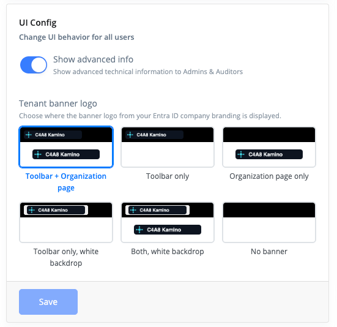
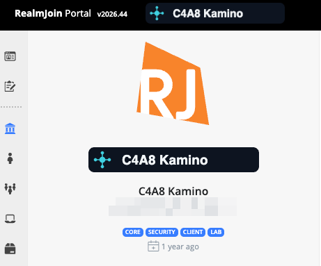
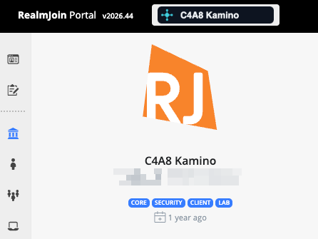
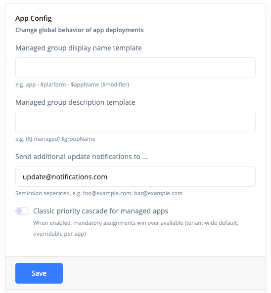

# General

## Runbook Sync

If you configure [Process Automation / Runbooks](../automation/runbooks/) in your environment, you can click "Sync runbooks..." to update your runbooks from RealmJoin's public repository.

.png>)

This will make sure, you have the current state of our runbooks, incl. bugfixes and new functionality. If needed, this will also install needed PowerShell modules in your Azure Automation Account.

## UI Config

The _UI Config_ card holds tenant-wide display settings of RealmJoin Portal. They apply to every user of the tenant. Changing them requires the `CanChangeTenantSettings` permission.

<figure><figcaption>
UI Config card
</figcaption></figure>

### Show advanced info

Off by default. When enabled, the detail pages show the raw [data sources](../ugd-management/user-group-device-management.md#data-sources) as JSON, as icons or tabs on the right of the tab bar:

| Detail page                                                       | Raw data views                                                  |
| ----------------------------------------------------------------- | --------------------------------------------------------------- |
| [Device](../ugd-management/user-list/device-details.md)           | Entra ID Data, Intune Data, Autopilot Data, MDE Data, RealmJoin Data |
| [User](../ugd-management/user-list/user-details.md)               | Entra ID Data, Sign-In Data, RealmJoin Data                     |
| [Group](../ugd-management/user-list/group-details.md)             | Entra ID Data, RealmJoin                                        |
| Package                                                           | Intune app, RealmJoin app and Package Store entry JSON          |
| [Organization](../ugd-management/organization-details.md)         | Entra ID Data                                                   |

The tabs are only shown to users with the **Admin**, **Auditor** or **Advanced Supporter** role and to Entra ID Global Administrators. The underlying permissions are the `CanSee...Json` permissions and `CanSeeUserSignIns`, see [Available Permissions](permission/custom-roles/available-permissions.md).

### Tenant banner logo

RealmJoin Portal can show your company logo in the toolbar at the top of every page and on the [Organization Details](../ugd-management/organization-details.md) page. Choose where the logo appears:

| Option                       | Toolbar | Organization page |
| ---------------------------- | ------- | ----------------- |
| Toolbar + Organization page  | ✓       | ✓                 |
| Toolbar only                 | ✓       | –                 |
| Organization page only       | –       | ✓                 |
| Toolbar only, white backdrop | ✓       | –                 |
| Both, white backdrop         | ✓       | ✓                 |
| No banner                    | –       | –                 |

_Toolbar + Organization page_ is the default. The toolbar has a dark background. The two _white backdrop_ options render the logo in the toolbar on a white background, for logos that are not readable on dark backgrounds. On the Organization Details page the logo is always shown without backdrop.

<figure><figcaption>
Toolbar + Organization page: logo in the toolbar and on the Organization Details page
</figcaption></figure>

<figure><figcaption>
Toolbar only, white backdrop: logo only in the toolbar, on a white background
</figcaption></figure>

The logo is the **Banner logo** of the default sign-in experience in your tenant's [Entra ID company branding](https://learn.microsoft.com/en-us/entra/fundamentals/how-to-customize-branding). RealmJoin Portal reads it from Graph (`GET /organization/{tenantId}/branding/localizations/default/bannerLogo`) and does not store a copy. Banner logos of language-specific localizations are not used. To change the logo, upload a new banner logo in the Entra admin center under **Company branding**.


If the default sign-in experience has no banner logo, no logo is shown and the previews on the card show a placeholder. RealmJoin Portal caches the logo for one hour, so a changed banner logo can take up to one hour to appear.


## Package Automation Defaults

If you source packages from RealmJoin's [Package Store](../application-management/packages/package-store/), you can use [automation ](../application-management/packages/package-updates.md#automation)to keep these packages always up to date.

.png>)

The settings are:

* **AutoDeployMain** - Automatically deploy new versions of this package to your users. ("Main" subscription)
* **AutoDeployMainDeferInDays** - Wait for this number of days to pass before publishing a new version to "main". This is usefull to avoid stress for users/clients if multiple package versions are published rapidly.
* **AutoDeployPreview** - Automatically deploy new versions of this package to your pilot users. ("Preview" subscription)
* **AutoDeployPreviewDeferInDays** - Wait for this number of days to pass before publishing a new version to "preview".
* **AutoDeployAtNight** - Schedule automatic deployment during night time
* **Select target timezone** - If you use AutoDeployAtNight, use this Time Zone to indicate when "at night" is.

See [Package Updates and Automation](../application-management/packages/package-updates.md#automation) for more information on Package Automation.

## Group Naming Scheme

RealmJoin Portal can dynamically create and manage Entra groups for features like [package assignment](../application-management/packages/package-deployment.md) and [remediation script assignment](../automation/remediation-scripts.md#assignment).

### App / Package Deployment

RealmJoin can create assignment groups for Intune and RealmJoin Client packages. Use this to define the naming pattern the groups.

<figure><figcaption>
Package Deployment Group Naming Scheme
</figcaption></figure>

You can use the following variables:

* **$vendor** - Name of the software vendor (if available)
* **$product** - Name of the software title
* **$appName** - Full name (vendor and product) of the software
* **$version** - Version of the package
* **$platform** - Platform of the package: `Win`, `macOS` or `Android`
* **$modifier** - either nothing, "available", "preview", "uninstall" or "update"
* **$groupName** - (only in description) Name of the Managed Group

If no template is set, RealmJoin uses `app - $platform - $appName ($modifier)`. Empty brackets are removed, so the Main group has no suffix.

### Remediation Scripts

If you use [RealmJoin managed Intune Remediation scripts](../automation/remediation-scripts.md#managed-scripts), you can define the naming scheme for [Managed Groups](../automation/remediation-scripts.md#managed-groups).

<figure><figcaption>
Remediation Scripts Group Naming Scheme
</figcaption></figure>

You can use the following variables:

* **$healthScriptName** - Name of the Managed Remediation Script
* **$modifier** - either "included" or "excluded" (Assignment vs. Exception)
* **$groupName** - (only in description) Name of the Managed Group

## Additional Update Notifications

For packages sourced from the [Package Store](../application-management/packages/package-store/), the RealmJoin backend regularly compares the deployed versions with the Package Store and sends an email per package when its status changes:

* **New version available** - a newer version of the package was published in the Package Store.
* **Manual deployment** - an upgrade action (update Main, update Preview, create Preview or move Preview to Main) is available and has to be triggered manually.
* **Planned deployment** - [package automation](#package-automation-defaults) has scheduled an upgrade action. The email contains the action and the scheduled time.

The field **Send additional update notifications to …** on the _App Config_ card takes email addresses that receive these emails for **every** package in the tenant. Separate multiple addresses with semicolons, e.g. `foo@example.com; bar@example.com`.

<figure><figcaption>
App Config card with an additional update notification recipient
</figcaption></figure>

This complements the [Technical Application Owners](../application-management/packages/package-settings.md#technical-application-owners) (TAO) of a package:

* **Technical Application Owners** are set per package and only receive notifications for that package, and only if notifications are enabled in the package's Config.
* **Additional update notification recipients** are set tenant-wide and receive the notifications for all packages, independent of the TAO settings.


Invalid email addresses are dropped without an error when saving, so check the field after saving. The addresses are stored as a JSON array with a maximum length of 200 characters. For more recipients, use a distribution list.


## Managed App Priority Cascade

The _App Config_ card also contains the tenant-wide switch **Classic priority cascade for managed apps**. It decides which assignment wins when a user or device is a member of both the Main (Required) and the Available group of a managed package:

* **Off** (default) - managed cascade: Available wins over Main (uninstall > update > preview > available > mandatory).
* **On** - classic cascade: Main wins over Available (uninstall > update > preview > mandatory > available).

Changing the switch asks for confirmation and takes effect immediately for every user and every managed package that has no per-package override. Individual packages can deviate from the tenant default via the _Priority cascade_ setting in their [Expert Settings](../application-management/packages/package-settings.md#expert-settings).

See [Assignment priority and conflicts](../application-management/packages/package-deployment.md#assignment-priority-and-conflicts) for the full evaluation order, including Exclude and Uninstall.

## Client Configuration

With this tenant setting you can configure the timespan in which the RealmJoin Agent detects the primary user.

<figure><figcaption></figcaption></figure>

## LAPS Configuration

With this tenant setting you can configure the expiration time of the RealmJoin LAPS Support Account.

<figure><figcaption></figcaption></figure>
