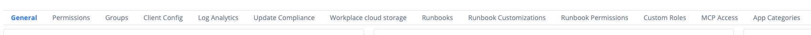
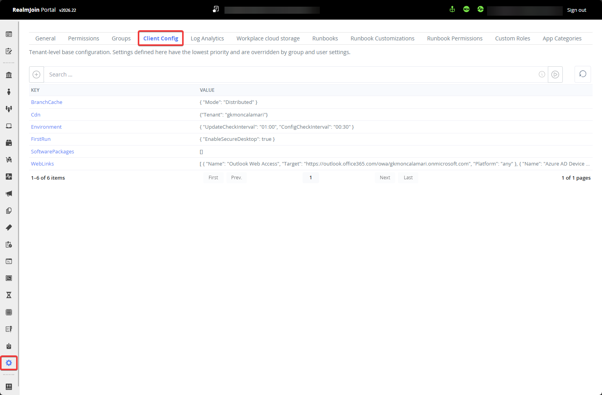
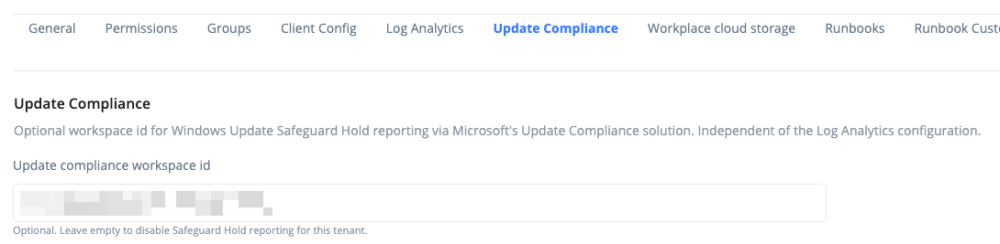

# Overview

The **Settings** page in the RealmJoin Portal holds the tenant-wide configuration: Portal roles, defaults for the RealmJoin Agent and for package deployment, and the connections to Azure resources (Azure Automation, Log Analytics, Azure Storage).

Each area of the settings lives on its own tab. The sections below describe the tabs in the order the Portal shows them and link to the page that covers each one in detail.

<figure><figcaption>
Settings tabs
</figcaption></figure>


Viewing the settings requires the `CanReadSettingsDetails` permission, changing them requires `CanChangeTenantSettings` (see [Available Permissions](permission/custom-roles/available-permissions.md)). Some tabs only appear when the matching feature is enabled for your tenant or when you hold a specific permission. Each section below names that condition.


## General

Tenant-wide defaults that do not need a tab of their own, grouped in cards:

* **Runbook**: sync your runbooks with RealmJoin's public repository.
* **UI Config**: change the Portal's appearance for all users, for example the tenant banner logo.
* **Client Configuration**: the timespan in which the RealmJoin Agent detects a device's primary user.
* **LAPS Configuration**: the expiration time of the RealmJoin LAPS support account.
* **App and remediation script deployment**: the group naming scheme RealmJoin uses when it creates assignment groups.
* **Package automation defaults**: whether and when new versions of Package Store packages are deployed automatically.
* **Multi Admin Approval**: email notifications for runbooks that need a second administrator's approval. Only shown with `CanChangeTenantSettings`.

Learn more: [General](general.md)

## Permissions

Delegate access to the RealmJoin Portal by assigning Entra ID groups to RealmJoin roles (role-based access control). The tab lists each role together with the Entra ID groups assigned to it.

Learn more: [Roles and Permissions](permission/README.md), [Pre-defined Roles](permission/pre-defined-roles.md)

## Groups

Define the group name prefixes RealmJoin uses (for example `app` for application assignment groups) and map them to descriptive titles. RealmJoin shows these titles when it refers to the groups. The groups themselves are not renamed.

Learn more: [Group Namespaces](groups.md)

## Client Config

The tenant-wide base configuration for the RealmJoin Agent, edited as key/value pairs. These settings have the lowest priority: anything assigned to the "RealmJoin - All Users" group, to a group or to a user overrides them.

Only shown with the `CanChangeTenantSettings` permission.

<figure><figcaption>
Client Config tab
</figcaption></figure>

Learn more: [Tenant Default Values](../ugd-management/user-and-group-settings/README.md#tenant-default-values), [Available RealmJoin Policies](../ugd-management/user-and-group-settings/additional-settings.md)

## Log Analytics

The Log Analytics workspace RealmJoin writes its logs to. The tab shows the current connection, the setup command for the RealmJoin PowerShell module and, when the deployed schema is outdated, the command to update it.

Learn more: [Connecting Azure Log Analytics Workspace](../monitoring-and-logs/log-analytics.md), [Migrating to the Log Ingestion API](../monitoring-and-logs/log-ingestion-api-migration.md)

## Update Compliance

An optional workspace ID for Windows Update for Business Reports (formerly Update Compliance). RealmJoin reads Safeguard Hold events from that workspace and shows them on the device details page. This is independent of the Log Analytics workspace RealmJoin writes its own logs to. Leave the field empty to disable Safeguard Hold reporting for this tenant.

Shown when your tenant uses the Log Ingestion API or has no Log Analytics connection yet. Tenants that still use the legacy Log Analytics connection (Data Collector API) set this workspace ID on the **Log Analytics** tab instead.

<figure><figcaption>
Update Compliance tab
</figcaption></figure>

Learn more: [Windows Update for Business Reports](../monitoring-and-logs/log-analytics.md#windows-update-for-business-reports)

## Workplace cloud storage

The connection string of the Azure Storage account behind Workplace Cloud Storage. Use **Reset setup** to run the configuration wizard again.

Only shown when Workplace Cloud Storage is enabled for your tenant.

Learn more: [Workplace Cloud Storage](workplace-cloud-storage.md)

## Runbooks

The Azure Automation account RealmJoin runs runbooks in: tenant, subscription, resource group, automation account, location, the runbook branch to sync and an optional Hybrid Worker group.

Learn more: [Connecting Azure Automation](../automation/connecting-azure-automation/README.md), [Runbooks](../automation/runbooks/README.md)

## Runbook Customizations

A JSON editor to adjust existing runbooks for your tenant: tenant-specific parameters and templates, user pickers or dropdowns, readable parameter descriptions, and hidden UI elements. Settings here override the defaults in the runbook itself.

Learn more: [Runbook Customization](../automation/runbooks/runbook-customization.md)

## Runbook Permissions

A JSON editor to control which users see which runbooks, and to hide runbooks for everyone.

Learn more: [Runbook Permissions](../automation/runbooks/runbook-permissions.md)

## Custom Roles

A JSON editor to define additional RealmJoin Portal roles from individual permissions, in addition to the pre-defined roles.

Only shown when Custom Roles are enabled for your tenant.

Learn more: [Custom Roles](permission/custom-roles/README.md), [Available Permissions](permission/custom-roles/available-permissions.md)

## MCP Access

Create and revoke the access tokens MCP clients use to connect to the RealmJoin MCP server. The tab lists all tokens of the tenant with owner, status, expiry and last use. A new token is shown once after creation.

Only shown to users with the RealmJoin Admin role or the Entra ID Global Administrator role (Portal policy `CanAdministerOwnTenant`, not assignable through custom roles), and only when the MCP server is enabled for your tenant.

Learn more: [MCP Server](../dev-reference/mcp-server.md)

## App Categories

The tenant's list of app categories. A RealmJoin package uses one of them as its group name in the RealmJoin Tray, an Intune app can have several as Intune app categories. Add, rename and delete categories here.

Only shown with the `CanReadAppCategories` permission. Editing requires `CanEditAppCategories`.

Learn more: [App Categories](app-categories.md)
