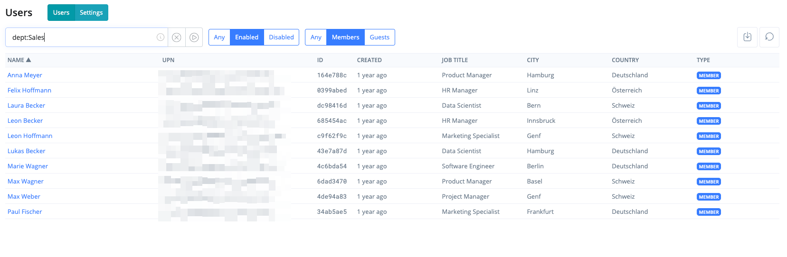

# Advanced Search

Advanced Search runs your search against a cached copy of the table's data held by the RealmJoin Portal instead of querying Microsoft Graph for every search. This keeps searches fast in tenants with many objects and allows column filters, operators and sorting across the whole list.


Advanced Search is available in the Users, Groups, Devices and Packages tables. Operators and all searchable columns are described in [Advanced Search Syntax](advanced-search-syntax.md).


Tables can be searched using the _basic_ or the _advanced_ search feature.


<mark style="background-color:yellow;">**All searches have to be confirmed by either using the**</mark><mark style="background-color:yellow;">**&#x20;**</mark>_<mark style="background-color:yellow;">**enter key**</mark>_<mark style="background-color:yellow;">**&#x20;**</mark><mark style="background-color:yellow;">**or the**</mark>  <mark style="background-color:yellow;">**symbol.**</mark>


### Basic Search

Basic Search uses the Graph API to directly query tenant data, providing real-time results.

Basic Search is always available as a fallback when Advanced Search is not. It also appears during the initial loading of the cached table, allowing users to search immediately—even before the cache is fully built.

### Advanced Search

Advanced Search splits text into words (tokens) and matches the beginning of each word. Unicode characters like Ø are supported. This enables partial name searches, so a query like "Ma Mu" can locate a user named "Maren Müller".

Additionally, information not displayed in the table is also searchable, like the UPN or, with a column-specific search, the postal code.

<figure><figcaption>
Users table filtered with the column filter <code>dept:Sales</code>
</figcaption></figure>


Please make sure to only use the "Reload-Button" in the top right corner if you are missing very recently added information from Entra / Intune.


### FAQ

#### How often is the data cached?

The table is cached on a schedule, currently set to 1 hour.

#### Can I refresh the data manually?

In the top right corner of each table, there's a button to refresh the cached data.

#### Can other users use my refreshed data?

The table is available for all users in the same RealmJoin portal instance. Thus, a triggered rebuild will do so for all those users.

#### What is a RealmJoin portal instance?

The RealmJoin portal has three different instances for load balancing and redundancy reasons.

#### How long will a rebuild/refresh of the advanced search take?

The rebuild time depends on the size of the tenant and the number of objects. It is not uncommon, that the rebuild might take several minutes. During the rebuild, only the basic search is available. All data is then queried directly via Graph, thus reducing the capabilities in filtering and speed.
