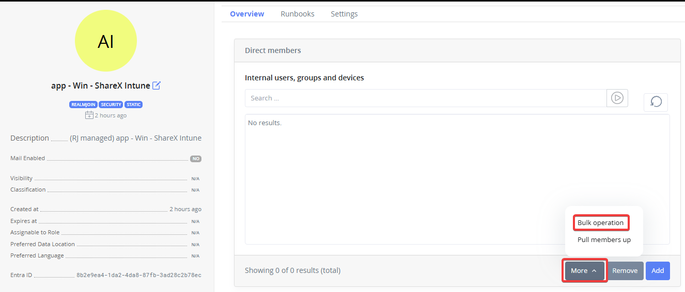
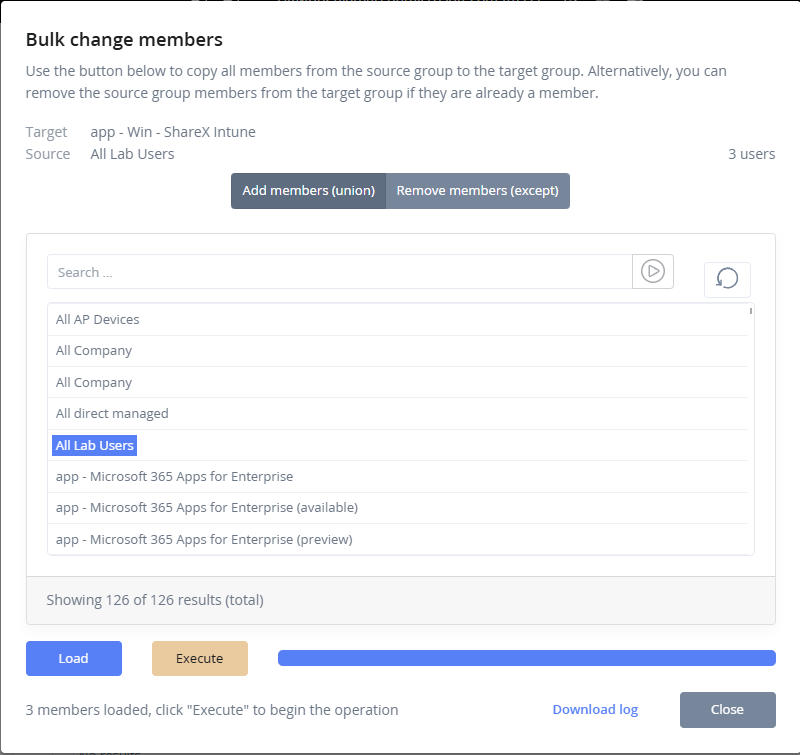
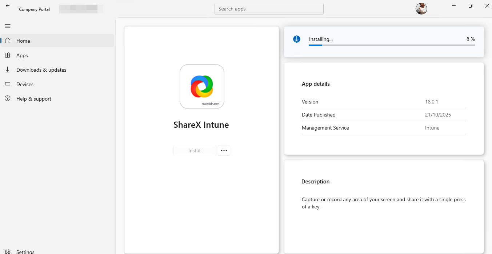
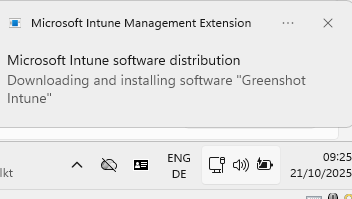

# Migration Guide: RealmJoin to Intune Managed Packages


We recommend staying with RealmJoin managed packages. Several package options are only available with the RealmJoin Agent, see [Deployment Methods](../deployment-methods.md#feature-comparison). Do not run RealmJoin and Intune managed packages in parallel for the same package or package family; use one deployment method per package to avoid conflicting installations.

Consult your RealmJoin solution architect before starting this migration.


### Key Concept

The RealmJoin and the Intune version of a package use the same detection fingerprint. The Intune package therefore detects installations made by the RealmJoin package as installed:

* Detection rules do not need to be reconfigured.
* Devices that already have the software are not reinstalled.
* Inventory and reporting continue across the switch.

### Migration Process

#### Step 1: Rename the RealmJoin Managed Package

Begin by renaming the existing RealmJoin managed package to free up the package name for reuse. This step is essential as Intune managed packages will use the same or similar naming convention.

**Actions:**

* Access the RealmJoin management portal
* Locate the package in the package management section
* Rename the package with a deprecation indicator (for example, append "\_legacy" or "\_deprecated" to the original name)
* Document the new name for reference

#### Step 2: Subscribe to the Intune Managed Package

After the RealmJoin package has been renamed, proceed with subscribing to the equivalent Intune managed package.

**Actions:**

* Navigate to the RealmJoin store
* Locate and select the package you wish to migrate to
* Complete the subscription process as Intune managed
* Verify that the package is properly registered in your Intune environment

**Note:** Use the original package name (now available after renaming the legacy package) to maintain consistency in your package naming schema.

#### Step 3: Transfer Users Using Bulk Operations (optional)

Transfer users from the RealmJoin managed package to the Intune managed package using the bulk operation function available in RealmJoin.&#x20;

**Actions:**

* Access the managed groups of the Intune package
* Under the _More_ section, select _Bulk Operations_
* Execute the bulk reassignment to the new Intune managed package
* Monitor the operation progress and verify successful transfers

<figure><figcaption>
Selecting the bulk operation feature to copy all users from a existing group
</figcaption></figure> <figure><figcaption>
Execution of the bulk operation. Users are added to the new group, a log is available for your reference.
</figcaption></figure>

### Post-Migration Verification

After completing the migration, perform the following verification steps:

* Verify all users have been successfully transferred to the Intune managed package
* Confirm that package detection is functioning correctly on client devices
* Check that no users remain assigned to the legacy RealmJoin package
* Review deployment status and ensure packages are installing correctly
* Validate that inventory and reporting data reflects the new Intune managed package

<figure><figcaption>
Available package is installed / updated via the company portal.
</figcaption></figure>

<figure><figcaption>
Mandatory assigned Intune package is updated. 
</figcaption></figure>

### Rollback Considerations

Should issues arise during migration:

* Retain the renamed RealmJoin package for a minimum grace period to enable potential rollback
* Document all migration steps and timestamps for troubleshooting
* Have a clear rollback procedure in place before beginning the migration
* Test rollback procedures in a non-production environment first
* Provide all information including full log files in any support ticket

