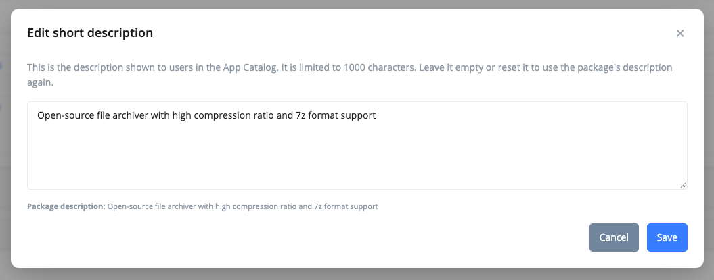

# Package Details

<figure><figcaption>
Package details page
</figcaption></figure>

The details page shows a single package in your environment. Open it by clicking a package in [Package Management](package-management.md).

It looks like the [Package Store details](package-store/#package-store-details) page, but describes your tenant's instance of the package rather than the generic store entry.

## Package types

This page can display any package that is understood by RealmJoin Portal, this includes

* **Managed** and **Basic** packages from the Package Store
* **Unmanaged** packages in Intune (not from the Package Store)
* **RealmJoin Classic** "Choco" and "Craft" packages

Different types of packages have different levels of support in the RealmJoin Portal. This guide focuses on **Managed** and **Basic** packages from the Package Store.

## Package properties

The left side of the page shows the core properties of the package and stays visible on every tab:

* **Display name**, **publisher** and **description**
* The [package badges](./#package-badges), such as _Generic_ and _Maintained_, plus the deployment method and subscription type, e.g. _RealmJoinManaged_. Badges are only shown for packages from the Package Store.
* **Package ID** ("Unique RJ ID")
* **Version** and, during a [preview](package-updates.md#staged-updates-with-preview), the preview version, plus the latest version in the Package Store
* **Package type**, **architectures**, **download size** and **install size**
* **Unique TVM ID**, **categories** and **platform**

The actions menu at the bottom of the left side contains **Delete**, which removes the package from your tenant. It does not remove the package from the store or uninstall existing deployments.

### Display name

Use the edit button next to the package's name to give it a custom display name relevant to your users. For packages hosted in Intune, this also renames the app in Intune. The package stays linked to its [Package Store entry](package-store/).

.png>)

### Short description

For packages deployed via the RealmJoin Agent, you can also overwrite the package's **Short Description**, which is the text users see for the package in the [App Catalog](../../realmjoin-agent/client-menu/self-service-portal.md#app-catalog-tab). The description shipped with the package is written from a packaging perspective and often explains its technical background. A custom description lets you tell users what the package means for them, e.g. _"Connects the printer on the 2nd floor of office building 5"_ for a printer mapping package.

<figure><figcaption>
Editing the short description of an existing package
</figcaption></figure>

* Use the edit button next to **Description** to open the editor. The package's own description is shown below the text field for reference.
* A custom description can be up to 1000 characters long.
* While a custom description is set, the package shows a **Customized** badge next to **Description**, and the App Catalog shows your text instead of the package's description.
* Use **Reset to package default** (or save an empty text) to go back to the package's description. Saving the unchanged package description does not create a custom description, so the package keeps following future description changes of the package.
* The custom description applies to your tenant only and is kept when a managed package is updated to a new version. The package's long description is not affected.

## Tabs

The right side of the page shows the following tabs:

* [**Overview**](#overview) - Description, updates, assignments, install status and usage.
* [**History**](#history) - Changes to the package in your environment and in the store.
* **Automation** - Managed packages only. Automatic rollout of new store versions, see [Automation](package-updates.md#automation).
* **Config** - Technical Application Owners, arguments and expert settings, see [Package Settings](package-settings.md).

Android apps only have the Overview tab.

### Overview

<figure><figcaption>
Overview tab
</figcaption></figure>

The Overview tab is split into sections, listed in the sidebar on the right:

* **Readme** - The long description of the package.
* **Update** - Shown when the Package Store offers a newer version. See [Update a package manually](package-updates.md#update-a-package-manually).
* **Assignments** - The groups, users and devices the package is assigned to. See [Package Assignments](package-deployment.md).
* **Install status** - How many devices have the package installed, failed to install it or have another version, with a breakdown of the exit codes.
* **Dependent Packages** - Packages that list this package in their [_Depends on_](package-settings.md#expert-settings) setting.
* **Technical Help** - If the package provides it, the supported [arguments](package-settings.md#arguments) and other requirements.
* **Vulnerabilities** - Known security vulnerabilities of the software, if available.
* **Usage** - The spread of versions across your devices, see below.

For Intune packages, the tab additionally shows the **Device status** and **User status** reported by Intune, separately for the main and the preview app.

#### Usage


The Usage section requires the RealmJoin Agent to properly populate data.


Use the usage table to determine the spread of versions deployed across your device fleet as well as your license count. Click the numbers under **Device Count** or **User Count** to see the devices or users using the respective version.

<figure><figcaption></figcaption></figure>

### History

The History tab shows when the package has been changed.

<figure><figcaption>
History tab
</figcaption></figure>

Two types of changes are tracked:

.png>) Changes to the instance of the package in your environment, e.g. publishing a newer version of the package to your users.

.png>) Changes to the Package Store entry.
