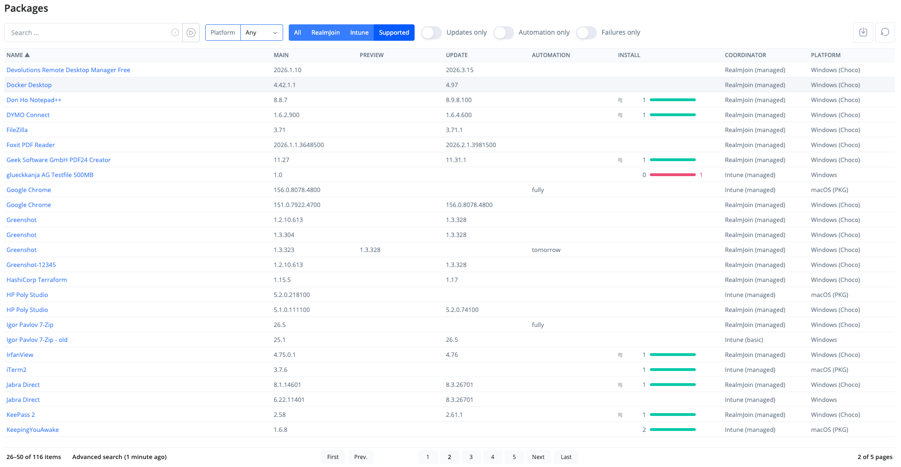

# Package Management Overview

Package Management (_Packages_ in the portal navigation) shows all packages that currently exist in your environment across RealmJoin and Microsoft Intune.

<figure><figcaption>
Package Management list
</figcaption></figure>

Clicking on the name of a package opens the package's [details page](package-details.md).

## Filters

**Platform** - Limit the list to **Win**, **Mac** or **Android** packages, or show **Any**.

**Source:**

* **All** - All packages across RealmJoin and Intune, including Intune apps that were not created by RealmJoin, such as mobile apps and Microsoft Store apps.
* **RealmJoin** - Only packages deployed via the RealmJoin Agent.
* **Intune** - All Intune apps, whether created by RealmJoin or not.
* **Supported** (default) - Only packages handled by RealmJoin: RealmJoin Agent packages and the Intune apps created by RealmJoin.

**Toggles:**

* **Updates only** - Only packages from the Package Store for which a newer version exists in the store.
* **Automation only** - Only packages from the Package Store with [update automation](package-updates.md#automation) configured.
* **Failures only** - Only packages with failed installations.

The toggles become available once the package list has been fully loaded.

## Columns

* **Name** - The display name of the package.
* **Main** - The version currently deployed to the Main group.
* **Preview** - The version currently in [preview](package-updates.md#staged-updates-with-preview), if any.
* **Update** - The latest version available in the Package Store, if it is newer.
* **Automation** - The [automation](package-updates.md#automation) state. Shows when the next automated update is due, or **ASAP** if it is due now. Without a pending update it shows which channels are automated: **fully**, **main only** or **preview only**.
* **Install** - A bar showing how many devices have the package installed, not installed, pending or failed.
* **Coordinator** - How the package is deployed: **RealmJoin (managed)**, **RealmJoin (basic)**, **Intune (managed)**, **Intune (basic)** or **Intune (unmanaged)** for Intune apps not created by RealmJoin.
* **Platform** - The platform of the package.

## Search, sort and export

The search box searches the list by any visible field, incl. name, version and platform. The results update as you type.

Click a column header to sort by that column. Use the export button next to the search box to download the current list.
