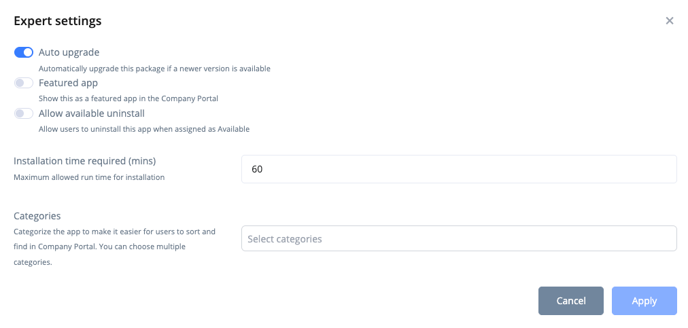

# Package Settings

The **Config** tab of the [package details page](package-details.md) holds the settings of a subscribed package. Automatic updates are configured on the Automation tab, see [Automation](package-updates.md#automation).

<figure><figcaption><p>Package Config</p></figcaption></figure>

The tab shows these cards:

* **Technical Application Owners** - Who is notified about this package.
* **Main app** - The settings of the main package: arguments, an internal team comment (RealmJoin only) and the **Expert settings** button.
* **Preview app** - The same settings for the preview package, shown while a [preview](package-updates.md#staged-updates-with-preview) is running.

Settings made here apply to the whole package. Individual assignments can deviate from them, see [Assignment settings](package-deployment.md#assignment-settings).

## Technical Application Owners

You can assign multiple **Technical Application Owners** (TAO) to a package by adding their email addresses with **Add recipient**.

To send them **automated notification emails** about package updates, turn on the **Enable** switch.

## Arguments

**Arguments on client execution** allow you to pass command line switches to an application installation. This is commonly used to customize your package with language options, a license key etc. that need to be present at installation time.


If a user already has the current subscribed version of a package installed and the package arguments are updated, the package will automatically re-run for that user using the new configuration.

If **Auto upgrade** is **OFF** and the user has an older version installed than the currently assigned one, the new configuration will **not** be applied.\
If **Auto upgrade** is **ON**, the user will receive both the new version and the updated configuration.


Some packages include a **Technical Help**, to explain possible **Arguments** and other Requirements.

.png>)

Intune packages for macOS have no arguments.

### Special arguments for Intunewin packages

For Intunewin packages we offer a configurable package update UI notification which lets the user interact with the install / update of an application and gives control over the process.

<figure><figcaption></figcaption></figure>

You can configure this dialog with the following settings in the arguments section:

```
--rjNotifyUser // Activate dialog
```

```
--rjNotifyAllowDefer[=n] // snooze option with x possible deferrals
```

```
--rjNotifyTimeout=n // when no user action is performed -> automatic snooze after x seconds (if deferral allowed), otherwise update
```

<figure><figcaption></figcaption></figure>

## Internal team comment

For RealmJoin packages, the **Internal team comment** field holds notes for your administrators. It is not shown to users.

## Expert Settings

The **Expert settings** button on the Main app or Preview app card opens advanced options for the package. RealmJoin and Intune packages offer different settings. Viewing them requires `CanSeeAppExpertSettings`, changing them `CanEditAppExpertSettings`.

<figure><figcaption><p>Expert Settings</p></figcaption></figure>



<table><thead><tr><th width="200">Setting</th><th>Explanation</th></tr></thead><tbody><tr><td>Allow reinstallation</td><td>Allows the user to <strong>reinstall</strong> the package at any time, overriding the current installation.<br>E.g.: suitable for packages that help fixing client issues via self-service (time sync, ...).</td></tr><tr><td>Allow background installation</td><td>Executes <strong>package updates directly</strong> after configuration updates have been detected on the device (standard RealmJoin sync interval: 30 minutes). Updates start without warning (no snooze option).<br>Do not use this option for regular packages as this might interrupt users when using the software.</td></tr><tr><td>Require compliance</td><td>The package is only <strong>installed</strong> once RealmJoin can verify that the device is <strong>compliant</strong> in Intune. This might stop the rollout for some time. The installation of the package and all other mandatory packages with higher order numbers are queued and only installed when the device is compliant.</td></tr><tr><td>Pre-release</td><td>Legacy setting, not available for managed packages. See <a href="https://docs-classic.realmjoin.com/rj-portal/software-packages">RealmJoin Classic</a>.</td></tr><tr><td>Auto upgrade</td><td><p><strong>Automatically upgrades</strong> existing installations when a <strong>newer version</strong> is assigned. If the assigned version is higher than the one on the device, RealmJoin re‑runs the package to update it.</p><p>Disable this option for packages with their own update mechanisms (e.g.: VPN client updated via gateway). When off, only new installations receive the newer version.</p><p>The RealmJoin Agent updates Required <em>and</em> Available packages.</p></td></tr><tr><td>Allow available uninstall</td><td>Allows users to <strong>uninstall</strong> the package when it is assigned as <strong>Available</strong>.</td></tr><tr><td>Only in VDI / Ignore in VDI</td><td>Execute this package on <strong>VDI</strong> devices (Windows 365 and Azure Virtual Desktop) only, or skip it there.</td></tr><tr><td>Only on hybrid-joined devices / Ignore on hybrid-joined devices</td><td>Execute this package on <strong>hybrid-joined devices</strong> only, or skip it there.</td></tr><tr><td>Ignore on private devices</td><td>Skip <strong>private</strong> devices (not Entra ID joined).</td></tr><tr><td>Group name</td><td>The <strong>category</strong> in which the package appears in the RealmJoin Tray menu.</td></tr><tr><td>Depends on</td><td><p>Prerequisite packages that must be installed before this package. RealmJoin installs all listed dependencies first. Make sure the dependencies are assigned as well (e.g. as Available).<br>Example: a runtime such as "Microsoft VC Redistributable Runtime" required for a software to run.</p><p>Enter the package ID (the "Unique RJ ID" of the package), either a single ID or a JSON array:<br><code>["package-id1","package-id2"]</code></p><p>Example:<br><code>["generic-microsoft-vcredist-2019","generic-microsoft-net-core-desktop-runtime-6"]</code></p></td></tr><tr><td>Order</td><td>Defines the installation sequence using an integer value. Lower numbers run first (e.g., <strong>10</strong> installs before <strong>100</strong>).<br>A value of <strong>0</strong> means "no sequence" and runs only after all numbered packages.<br>Order numbers are applied <strong>only during the initial client rollout</strong>.</td></tr><tr><td>Priority cascade</td><td>Managed packages only. Decides which assignment wins when a user or device matches both the Main and the Available group of this package:<br><strong>Use tenant default (recommended)</strong> - follows the tenant-wide switch in Settings > General > App Config.<br><strong>Managed cascade</strong> - Available wins over Main.<br><strong>Classic cascade</strong> - Main wins over Available.<br>See <a href="package-deployment.md#managed-and-classic-priority-cascade">Priority cascade</a> for details.</td></tr><tr><td>Deployment rate</td><td><p>Lets users <strong>defer</strong> the installation until a fixed date. The options are <strong>NoChange</strong> (no deferral), <strong>Tomorrow</strong> (+1 day), <strong>Fast</strong> (+3 days) and <strong>Slow</strong> (+7 days). For Fast and Slow, a date on a weekend is moved past the weekend. The dialog shows the resulting date.</p><p>The date is stored as a fixed value when you save, it does not move with the device's last check-in. After that date, the installation runs without further deferral.</p><p><strong>Note:</strong> Installations are staged: they are triggered several times a day with a certain probability per trigger. This ensures a smoother rollout and makes good use of BranchCache and Delivery Optimization.</p></td></tr><tr><td>Main app restrictions</td><td><p>Defines <strong>who</strong> runs the package and <strong>when</strong> (<strong>phase</strong>).</p><p>Users: <strong>Only primary user</strong> (the device's primary user as shown in the RealmJoin Portal), <strong>Only secondary users</strong> or <strong>Both</strong>.</p><p>Phases (default: <em>Normal, Initial &#x26; Manual</em>):</p><p><strong>Logon</strong>: The package runs after the user has logged on.<br><strong>Manual</strong>: The package runs when the user starts the installation manually via the tray menu.<br><strong>Initial</strong>: The package runs during the initial client deployment.<br><strong>Normal</strong>: Neither Logon, Manual nor Initial; deployment during normal use of a device.</p></td></tr><tr><td>User part restrictions</td><td>Same options as before, but for the user part of the package (if it has one), e.g. settings or scripts executed in the user's context instead of the system context.</td></tr></tbody></table>


**Do not use _Depends on_ and _Order_ on the same package.**\
During the initial rollout (or any mandatory rollout after login), RealmJoin first installs all dependency packages, then the original packages. This two‑stage process overrides and can nullify any defined order numbers.

For example:

* Package A, order 1
* Package B, order 101 and depending on Package C, order 100.
* If all packages are assigned as mandatory, the installation sequence will be C, A, B.

User settings within application packages are treated as a set dependency.




<figure><figcaption><p>Expert settings of an Intune Windows app</p></figcaption></figure>

<table><thead><tr><th width="200">Setting</th><th>Explanation</th></tr></thead><tbody><tr><td>Auto upgrade</td><td><strong>Automatically upgrades</strong> existing installations when a newer version is assigned. Intune only updates <strong>Required</strong> assignments. To keep <strong>Available</strong> apps up to date, enable the <a href="update-group.md">Update Group</a>.</td></tr><tr><td>Featured app</td><td>Shows the app as a featured app in the Company Portal.</td></tr><tr><td>Allow available uninstall</td><td>Windows only. Allows users to uninstall the app from the Company Portal when it is assigned as Available.</td></tr><tr><td>Installation time required (mins)</td><td>Windows only. The maximum run time of the installation.</td></tr><tr><td>Pre-install script / Post-install script</td><td>macOS PKG apps only. Shell scripts that run before the installation or after a successful installation. Leave empty to use the package default, if any.</td></tr><tr><td>Categories</td><td>The categories under which the app appears in the Company Portal. Only shown if your tenant has <a href="package-store/package-store-details.md#app-categories">app categories</a>.</td></tr></tbody></table>


