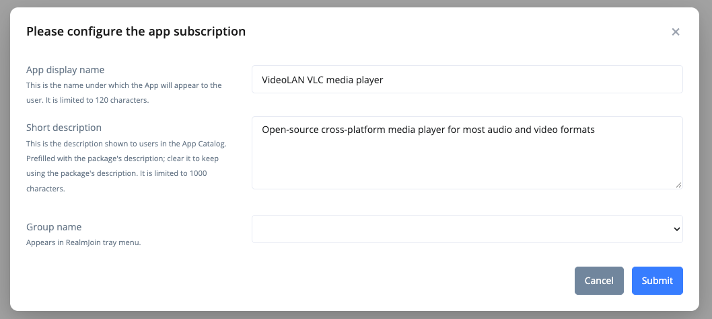

# Subscribing to a Package


Video tutorial


Subscribing adds a package from the [Package Store](./) to your tenant. Afterwards it appears in [Package Management](../package-management.md) and can be [assigned](../package-deployment.md) to users and devices.


No license is acquired with the subscription. You are solely responsible for any licensing agreements with the vendor of the software.


## Choose deployment method and subscription type

<figure><figcaption>
Subscribe buttons
</figcaption></figure>

The **Subscribe** section on the Overview tab of a store entry offers up to four buttons, depending on the deployment methods enabled for your tenant:

* **Use RealmJoin (managed)** - recommended
* **Use RealmJoin (basic)**
* **Use Intune (managed)**
* **Use Intune (basic)**

The first part decides the [deployment method](../../deployment-methods.md): the RealmJoin Agent or an `intunewin` app in Intune. The second part decides the subscription type: **managed** packages come with RealmJoin-managed Entra ID groups, **basic** packages are assigned manually. See [Managed and basic subscriptions](../#managed-and-basic-subscriptions).

If no button is shown, no deployment method is enabled for this package in your tenant. Please contact support to subscribe to it.

## Configure the subscription



### Review the package

The button opens a preview of the package as it will appear in your tenant. Craft packages show the [suffix](#craft-packages-suffix) here.



### Click Continue

The dialog **Please configure the app subscription** opens.



### Adjust the settings and submit

<figure><figcaption>
Configuring the category/group name during subscription
</figcaption></figure>

* **App display name** - The name under which the app appears to users, up to 120 characters. It must be unique among your RealmJoin and Intune apps; if the name is already taken, the dialog links the existing app.
* **Short description** - RealmJoin deployment only. The description users see in the [App Catalog](../../../realmjoin-agent/client-menu/self-service-portal.md#app-catalog-tab), up to 1000 characters. The field is prefilled with the package's description; replace it with a text that tells your users what the package is for. Only a changed text is stored as a custom description. You can change or reset it later on the [package details page](../package-details.md#short-description).
* **Group name** (RealmJoin) - The category under which the app appears in the RealmJoin Tray menu.
* **Categories** (Intune) - One or more categories under which the app appears in Intune and the Company Portal.

App display name and short description require the `CanEditAppDisplayName` [permission](../../../administration-and-settings/permission/custom-roles/available-permissions.md). Group name and categories are only shown if your tenant has app categories.

Click **Submit** to start the subscription. The page shows the progress until the package is created in your tenant.



<figure><figcaption>
Short description in the app subscription dialog
</figcaption></figure>

### App categories

The available categories are managed in the [App Categories](../../../administration-and-settings/settings.md#app-categories) tab of the portal settings. The same list is used for the RealmJoin group name and the Intune categories.

<figure><figcaption>
All categories available in the tenant
</figcaption></figure>

You can change the category later in the package's [Expert Settings](../package-settings.md#expert-settings).

## Multiple subscriptions of one package

### Craft packages (suffix)

Craft packages are often used for configurations such as printer or network drive mappings, which need to be subscribed and assigned multiple times. Because RealmJoin accepts every package ID only once, each subscription of a craft package gets a suffix that turns the ID `this-id` into `this-id#suffix`.

If you do not set a suffix, a random one is used and the page shows the resulting ID. To choose your own suffix, click **Set suffix** before continuing. A suffix may contain letters, digits, `-` and `_`.

<figure><figcaption></figcaption></figure>


The suffix is only available for RealmJoin deployment.


### Choco and Intune packages

If you need multiple configurations of an application, e.g. "Microsoft 365 Apps for Enterprise" in different languages, subscribe to it multiple times and give each subscription its own **App display name**, e.g. "Microsoft 365 Apps for Enterprise - DE". The name is reflected in the managed groups RealmJoin creates.


Suffixes are not available for these packages. Subscriptions of the same Chocolatey or `intunewin` package share the same identifier, so a user can only have one of them installed at a time. Do not assign multiple subscriptions of the same package to the same user; this results in conflicts and is not supported.

