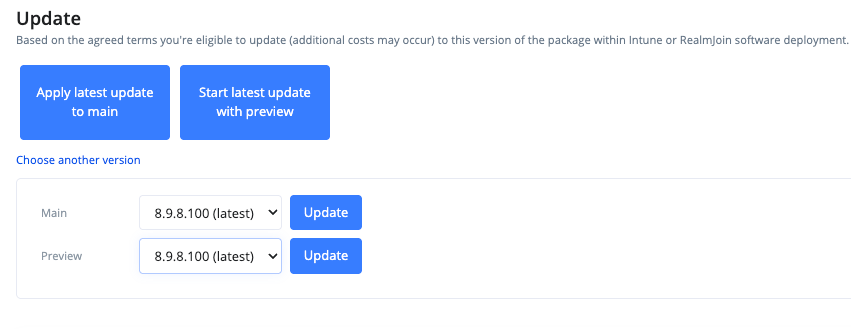

# Package Updates and Automation

When the Package Store offers a newer version of a package you subscribed to, you can roll it out manually or let RealmJoin do it automatically. Managed packages support a staged rollout through a **Preview** group.

## Staged updates with preview

For managed packages, RealmJoin keeps two versions of a package side by side:

* **Main** - The version assigned to the Main and Available groups, i.e. to most of your users and devices.
* **Preview** - A newer version assigned only to the Preview group, e.g. pilot users who test it first. The preview is a separate instance of the package and only exists while a preview is running.

A typical update cycle is:

1. A new version appears in the Package Store.
2. The new version is started as preview and tested by the members of the Preview group.
3. The preview is applied to main. All other users and devices receive the new version, and the preview ends.

[Package Management](package-management.md) shows the Main and Preview versions and the latest store version of each package.

## Update a package manually

If the Package Store offers a newer version than the one deployed in your environment, the **Update** section on the Overview tab of the [package details page](package-details.md) shows the available actions.

For managed packages:

* Without a running preview: **Apply latest update to main** or **Start latest update with preview**
* With a running preview: **Apply preview to main**, and if the store has an even newer version, **Update running preview with Store version**

Basic packages only offer **Apply update**.

Updating requires the `CanSubscribeApp` and `CanUpgradeApp` [permissions](../../administration-and-settings/permission/custom-roles/available-permissions.md). Updating Main requires at least one assigned Main group.

### Choose another version

By default, an update always targets the latest version in the Package Store. If you want to skip a version or need a specific one, click _Choose another version_ below the update buttons. A dropdown lists the eligible versions, the latest one marked with "(latest)"; select one and confirm with _Update_. For managed packages there is one row per target: _Main_, _Preview_ (start a preview) and _Update preview_ (move an existing preview).

<figure><figcaption>
Choose another version
</figcaption></figure>

The option is only shown when all of the following apply:

* The package was subscribed from the Package Store and an update is available (the _Update_ section is visible).
* No update or other operation is currently running for this package.
* The Package Store holds at least **two** versions newer than the version currently deployed in that slot (Main or Preview). With only one newer version, the regular update button already targets it.
* For _Main_: **Automate Main channel** is off. For _Preview_: **Automate Preview channel** is off (see [Automation](#automation)). Updating an already running preview is not affected by automation.

### Downgrades


**Downgrades are not possible.** The dropdown only lists versions newer than the one currently deployed, and the backend rejects any update that targets an older version. To deploy an older version, open that version's entry in the Package Store (the [Versions tab](package-store/#versions-tab) links every changelog row to its store entry) and subscribe from there. Since each package ID can only be subscribed once, this requires removing the existing subscription first.


### How devices pick up a new version

Changing the assigned version does not reinstall the package everywhere:

* Existing installations only follow the new version if [Auto upgrade](package-settings.md#expert-settings) is enabled for the package. Devices that install the package for the first time always get the assigned version.
* The RealmJoin Agent does not replace a newer version that is already installed on a device unless the client policy [Allow downgrade of packages](../../ugd-management/user-and-group-settings/additional-settings.md#softwarepackaging.autoupgradecandowngrade) is set.
* For Intune, Auto upgrade only updates Required assignments. To keep Available apps up to date, use the [Update Group](update-group.md).

## Automation

<figure><figcaption>
Package Automation
</figcaption></figure>

For managed packages, the **Automation** tab of the package details page lets RealmJoin roll out new store versions automatically.

* **Automate Main channel** - Automatically deploy new versions to Main. If a preview is running, this applies the preview to main.
* **… defer X days** - Wait this number of days (0-90) before the automated step for Main. For a new store version, the days count from its release in the store; for a running preview, they count from the start of the preview.
* **Automate Preview channel** - Automatically start new versions as preview.
* **… defer X days** - Wait this number of days (0-90) after the release of a new store version before starting it as preview.
* **Deploy at Night** - Move automated deployments that would fall between 06:00 and 23:00 into the night.
* **Select target timezone** - The time zone that defines "night" for _Deploy at Night_. Without a time zone, UTC is used.

If a defer field is left empty, the channel is never updated automatically. New subscriptions use the [automation defaults](../../administration-and-settings/general.md#package-automation-defaults) of your tenant. Configuring automation on a package overrides these defaults for that package.

### How the channels work together

* **Only Main automated** - New versions go straight to Main once the Main defer period has passed. A preview you start manually is applied to main automatically after the Main defer period.
* **Only Preview automated** - New versions are started as preview automatically. You apply the preview to main manually after testing.
* **Both automated** - New versions are started as preview first and applied to main after the Main defer period.


While a preview is running, it is never replaced automatically by a newer store version. The next version only enters Preview after the current preview has been applied to main. This ensures that a running test is not invalidated by a newer version.



Recommendation:

* Automate only **Main channel** for software that can upgrade without prior testing, such as web browsers from major vendors.
* Automate both channels, or only **Preview channel**, for software you want to test before deploying.

You can always update manually to skip a version you don't want published.


The [Automation](package-management.md#columns) column in Package Management shows when the next automated update is due.
