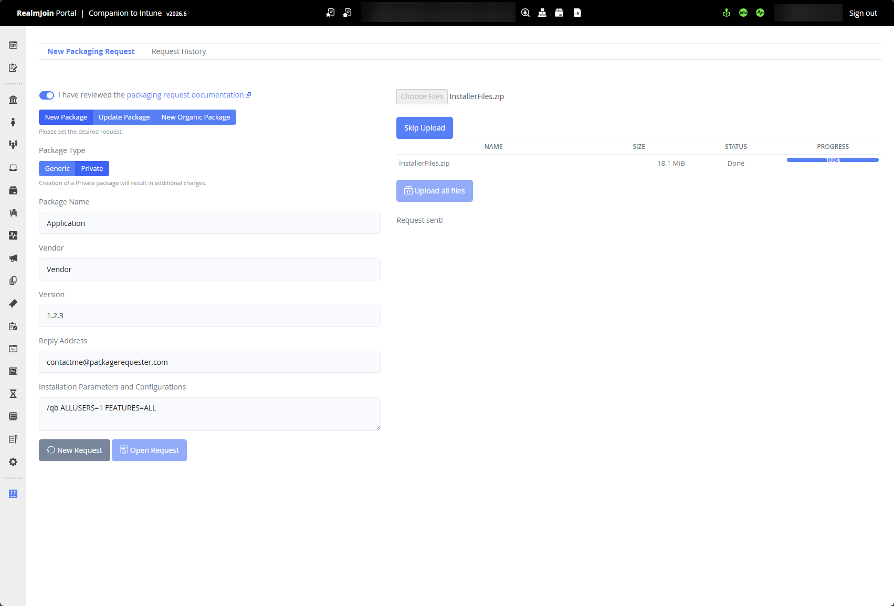
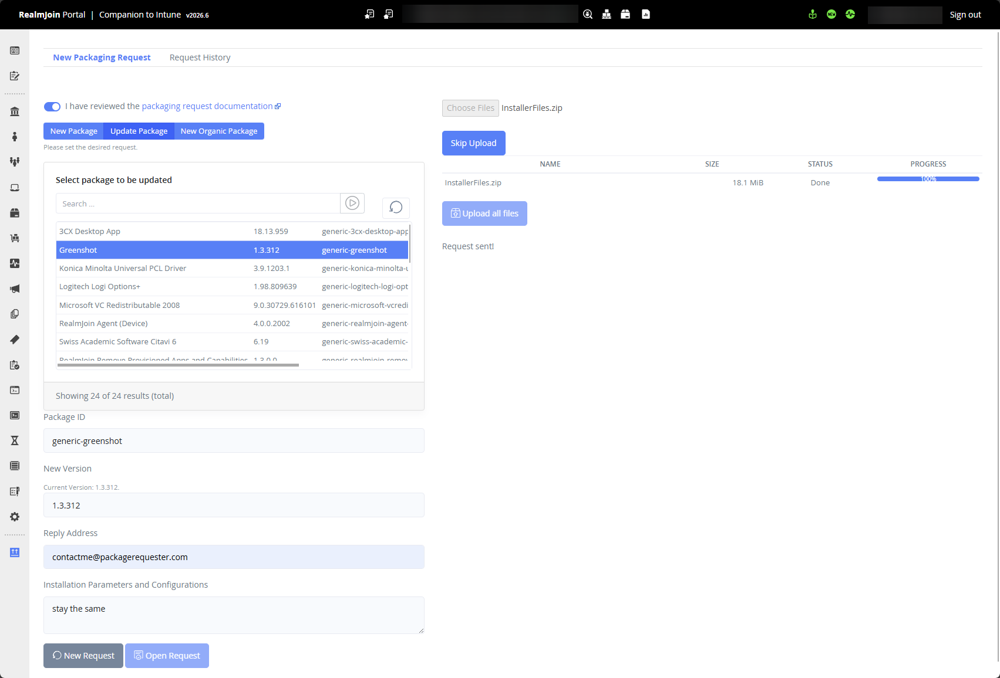

# Packaging Requests

## Architecture (Win11 & macOS)

The RealmJoin Packaging Factory packages applications for Windows 11.

macOS packaging is in preview. macOS requests are accepted on a best‑effort basis; processing times and availability may vary.

### Custom vs Generic Packaging

We aim to create packages as **generic** as possible: unmodified vendor installers without customer-specific alterations, available to all customers in the Package Store. All settings are then configured in the RealmJoin Portal after subscribing.

**Custom** packages are used for modified installers, including those customized by the vendor for the customer, such as SAP, or for customer-developed apps and similar cases. They are only visible in the _Custom_ section of your Package Store. See [Package kinds](../#package-kinds).

We invite customers to share their evaluation on whether an application can be packaged as _generic_ or requires a _custom_ package, however, the final decision is made by the RealmJoin Packaging Factory. Custom packaging is an add-on and incurs additional costs; if it is not part of your plan, the _Custom_ option in the request form is disabled.

## Request Types

Requests are submitted on the **New Packaging Request** tab of _Request Package_ in the RealmJoin Portal. Your previous requests are listed on the **Request History** tab.

Three request types are available: **New Package**, **Update Package** and **New Organic Package** (see [Organic Packages](organic-packages.md)). New Package and Update Package require the `CanRequestSoftwarePaas` [permission](../../../administration-and-settings/permission/custom-roles/available-permissions.md#software-requests), New Organic Package requires `CanRequestSoftwareOrganic`. Before submitting, confirm that you have reviewed this documentation.

### New Packages

If an application is not available in the RealmJoin Store, it can be requested for packaging via the RealmJoin Packaging Factory. A valid PACKaaS request must include:

* **Package Type** - _Generic_ (when no customer‑specific data is included) or _Custom_ (additional fees apply). The Packaging Factory may change a request from generic to custom if justified, for example when customer‑specific details are identified during processing. Customers will be informed of such changes before the request is completed.
* **Package Name**, **Vendor** and **Version**.
* **Override Reply Address** - The email address that receives all communication about the request. It may differ from the signed-in user's address and is required if your account has no mailbox.
* **Installation Parameters and Configurations** - All required configuration switches as command‑line parameters, registry keys, configuration files, or similar (up to 2047 characters; longer instructions can be added as files to the upload). Silent/unattended installation commands are always required. Screenshots are not accepted; PACKaaS does not include Scripting‑as‑a‑Service.
* **Description** (optional) - Any additional context you want to pass to the Packaging Factory.
* **Application binaries** - After clicking **Open Request**, upload the binaries and click **Upload all files**. Binaries must always be uploaded for new packages; a download URL may be added for reference but is **not** sufficient. If there are multiple files, please use a zip container.


When you enter a package name, the form lists existing Package Store packages that match it, so you can check whether the software is already available before requesting it.


<figure><figcaption>
RealmJoin packaging request form for new requests.
</figcaption></figure>

### Package Updates

If an application is required in a newer version than the one available in the RealmJoin Store, the same processes and requirements apply as for new package requests. Select the package from the dropdown, which lists the packages subscribed in your tenant; update requests can only be submitted for those packages. Enter the **New Version** and the **Installation Parameters and Configurations**. If the parameters have not changed, refer to the previous version's parameters.

**Skip Upload** is only available for update requests, e.g. when you only add parameters to an existing package.

<figure><figcaption>
RealmJoin package request form for package updates.
</figcaption></figure>


Note: Additional switches, new parameters or configuration files for an existing package are considered updates and shall be requested the identical way.



**Tickets, Files and Setup**

Please note that:

* all update and new package requests necessitate the provision of both binaries and documentation detailing the required command line parameters. Silent/unattended installation parameters are not optional and **must** be provided.
* the request creates a ticket. All communication will be handled in this ticket and is only sent to the reply address. If your account has no mailbox, the form asks for a reply address with an active mailbox. Once the ticket is created, the reply address can not and will not be changed.
* the [Software Requester](../../../administration-and-settings/permission/pre-defined-roles.md#software-requester-permissions) role can be assigned to any user group in the tenant, therefore, an ADM account may not be required.
* organic packages and PACKaaS might be not available right away, please get in touch with support@realmjoin.com if a feature is missing
* any incomplete request will be rejected.

