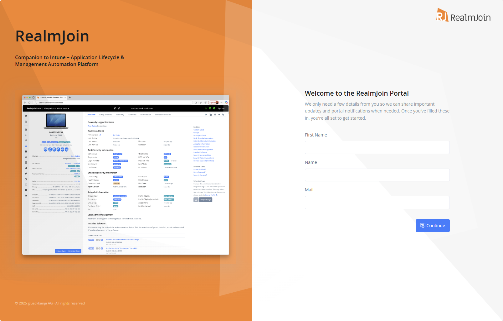
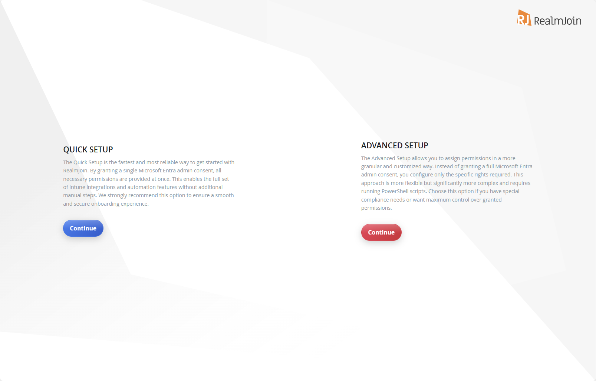

# Onboarding

## Self-onboard RealmJoin Portal



#### Sign in as a Global Admin

Visit [https://portal.realmjoin.com](https://portal.realmjoin.com) and sign in as **Global Admin** of your Entra ID Tenant.

<figure><figcaption></figcaption></figure>



#### Accept Permissions

Select "Consent on behalf of your organization" to approve the RealmJoin Portal on behalf of your organization.

<figure><figcaption>
The App will request basic permissions needed to interact with the RealmJoin Portal. These permissions are required for any user interacting with RealmJoin Portal - e.g. to use self-services.
</figcaption></figure>



#### Fill in the form

The nominated email will receive important updates and portal notifications.

<figure><figcaption></figcaption></figure>



#### Select "Quick Setup" or "Advanced Setup"

* **Quick Setup** grants all core and optional RealmJoin Portal permissions with a single admin consent. This is the recommended option for most organizations.
* **Advanced Setup** lets you select the granted permissions individually with the RealmJoin PowerShell module. Choose it if your organization has special compliance needs or requires maximum control over granted permissions.

You can switch from Quick Setup to Advanced Setup later; the switch is one-way. In both setup types, the RealmJoin Client app (required for the RealmJoin Agent) and the security features (Microsoft Defender for Endpoint) are activated separately on the [features page](https://portal.realmjoin.com/organization/features). See [Getting Started](../getting-started/#decision-1-quick-setup-or-advanced-setup) for a side-by-side comparison.

<figure><figcaption></figcaption></figure>




[advanced-setup.md](advanced-setup.md)

