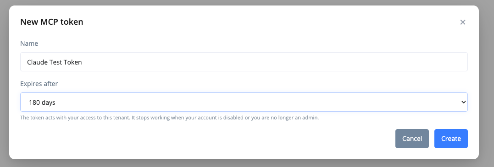
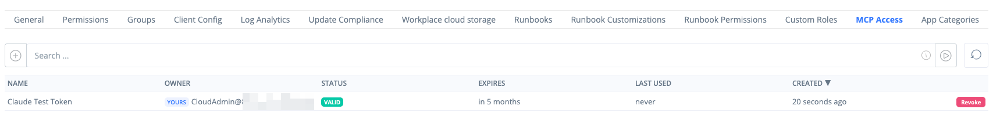

# MCP Server

RealmJoin runs a [Model Context Protocol](https://modelcontextprotocol.io/) (MCP) server as part of the RealmJoin Customer-API. MCP clients, for example AI assistants and IDE agents, connect to it with an MCP access token and call its tools to read device state and software data of your tenant.

All tools are read-only. The MCP server cannot change devices, packages, assignments or settings.

## Requirements

* The MCP server is enabled for your tenant. The feature is enabled by RealmJoin; contact RealmJoin Support to have it enabled.
* Creating and revoking tokens requires an administrator role in the RealmJoin Portal: the RealmJoin **Admin** role or the Entra ID **Global Administrator** role (Portal policy `CanAdministerOwnTenant`; it cannot be granted through [Custom Roles](../administration-and-settings/permission/custom-roles/README.md)). The **MCP Access** settings tab is only shown with this role and while the feature is enabled.
* An MCP client that supports the Streamable HTTP transport and can send a custom `Authorization` header. The MCP server does not offer OAuth sign-in, so clients that only connect to remote servers through OAuth cannot use it.

## Endpoint and authentication

| Property       | Value                                    |
| -------------- | ---------------------------------------- |
| URL            | `https://customer-api.realmjoin.com/mcp` |
| Transport      | Streamable HTTP                          |
| Authentication | `Authorization: Bearer <MCP token>`      |
| Server name    | `realmjoin`                              |

The endpoint accepts MCP access tokens only. The username and secret used for the [RealmJoin API](realmjoin-api/authentication.md) (HTTP Basic) are not accepted here.

Every request is checked for:

1. A valid token: it exists, is neither expired nor revoked, and its secret matches.
2. An authorized owner: the user who created the token still has an enabled account and an administrator role that reaches the tenant (see [Token owner check](mcp-server.md#token-owner-check)).
3. An active tenant with the MCP server feature enabled.

| Response                | Cause                                                                                                       |
| ----------------------- | ----------------------------------------------------------------------------------------------------------- |
| `401 Unauthorized`      | No bearer token, malformed token, unknown, expired or revoked token, or the token owner fails the owner check. |
| `403 Forbidden`         | The MCP server feature is not enabled for the tenant, or the tenant is disabled.                            |
| `429 Too Many Requests` | The tenant's rate limit is exhausted (see [Rate limit](mcp-server.md#rate-limit)).                          |

## MCP access tokens

MCP access tokens are managed in the RealmJoin Portal under **Settings** > **MCP Access**.

### Create a token



### Open MCP Access

In the RealmJoin Portal, open **Settings** > **MCP Access** and click **Add new** (plus icon) next to the search field.



### Name the token and choose its lifetime

In **New MCP token**, enter a **Name** that identifies the client or purpose, for example `Claude Desktop` (required, up to 100 characters). Select **Expires after**: 30, 90 (default), 180 or 365 days. Click **Create**.

<figure><figcaption><p>New MCP token</p></figcaption></figure>



### Copy the token

The dialog **MCP token created** shows the token once. Copy it and store it in a secret store before you click **Done**. RealmJoin stores only a hash of the token secret, so the token cannot be displayed again. If it is lost, create a new token and revoke the old one.



A token has the format `rjm_<tenant ID>.<token ID>.<secret>`. It is bound to the tenant that is selected in the Portal when the token is created and to the user who creates it. A token created by a partner administrator in a customer tenant gives access to that customer tenant only.

### Token list

The **MCP Access** tab lists all tokens of the tenant, created by any administrator, newest first. The search field filters by name and owner.

<figure><figcaption><p>MCP Access tab</p></figcaption></figure>

| Column    | Content                                                                                                     |
| --------- | ----------------------------------------------------------------------------------------------------------- |
| Name      | The name entered at creation.                                                                               |
| Owner     | User principal name of the user who created the token. **Yours** marks your own tokens.                     |
| Status    | **Valid**, **Expired** or **Revoked**. Hovering over **Revoked** shows who revoked the token.               |
| Expires   | Expiry time. Tokens created before expiry became mandatory show **after next use**: they get an expiry of 90 days from their next use. |
| Last used | Time of the last authenticated request, updated at most once per minute, or **never**.                     |
| Created   | Creation time.                                                                                              |

### Revoke a token

Click **Revoke** in the token's row and confirm. Every administrator can revoke every valid token of the tenant, including tokens of other users. Revocation takes effect with the next request. Revoked and expired tokens stay in the list with their status; they cannot be reactivated.

### Token owner check

A token acts with the access of the user who created it. On every request, RealmJoin checks the owner in their home tenant:

* The user account exists and is enabled.
* The user currently holds a role that grants `CanAdministerOwnTenant`: the RealmJoin **Admin** role (see [Pre-defined Roles](../administration-and-settings/permission/pre-defined-roles.md#admin-permissions)) or the active Entra ID **Global Administrator** role.
* For a tenant other than the home tenant, the home tenant is registered as that tenant's partner.

The result is cached for 5 minutes. A disabled account or a removed admin role therefore stops the user's tokens within 5 minutes, without revoking them. If the check cannot be completed, for example because Microsoft Graph is unavailable, requests are denied for 1 minute.


The check uses the owner's current group memberships and active directory roles. If the owner's admin access comes from Privileged Identity Management (PIM), their tokens only work while the group membership or role is activated.


## Connect a client

Configure the client with the endpoint URL and an `Authorization` header that carries the token. The configuration format depends on the client. Keep the token out of configuration files that are committed to source control; use the client's mechanism for environment variables or secret prompts instead.



Clients that use the `mcpServers` JSON format, with the token taken from the environment variable `REALMJOIN_MCP_TOKEN`:

```json
{
  "mcpServers": {
    "realmjoin": {
      "type": "http",
      "url": "https://customer-api.realmjoin.com/mcp",
      "headers": {
        "Authorization": "Bearer ${REALMJOIN_MCP_TOKEN}"
      }
    }
  }
}
```

Whether `${...}` variables are expanded depends on the client.



```bash
claude mcp add --transport http realmjoin https://customer-api.realmjoin.com/mcp \
  --header "Authorization: Bearer $REALMJOIN_MCP_TOKEN"
```

The shell expands `$REALMJOIN_MCP_TOKEN` when the command runs, and Claude Code stores the resulting header in its configuration.



`.vscode/mcp.json`; VS Code prompts for the token on first start and stores it in its secret storage:

```json
{
  "inputs": [
    {
      "type": "promptString",
      "id": "realmjoin-mcp-token",
      "description": "RealmJoin MCP token",
      "password": true
    }
  ],
  "servers": {
    "realmjoin": {
      "type": "http",
      "url": "https://customer-api.realmjoin.com/mcp",
      "headers": {
        "Authorization": "Bearer ${input:realmjoin-mcp-token}"
      }
    }
  }
}
```



## Available tools

All tools return JSON as text and only read data of the tenant the token is bound to. Device data comes from the device state the RealmJoin Agent reports; devices without the agent are not found. Software data comes from [Software Reporting](../analyze-and-export/software-reporting.md).

| Tool                  | Parameters                                     | Returns                                                                                               |
| --------------------- | ---------------------------------------------- | ----------------------------------------------------------------------------------------------------- |
| `get_tenant_overview` | none                                           | Active and total device and user counts, number of software packages, activity threshold.             |
| `search_devices`      | `query`                                        | Up to 25 devices matching a machine name or device ID prefix.                                         |
| `get_device_by_name`  | `name`                                         | Full device state of the most recently seen device with that name.                                    |
| `get_device_state`    | `deviceId`, optional `paths`, optional `full`  | Summary, selected sections or the full device state of one device.                                   |
| `list_packages`       | optional `search`                              | Up to 50 software packages with device and user counts.                                               |
| `get_software_report` | `packageId`                                    | Installed versions of one package with device, user and usage counts.                                 |

### get\_tenant\_overview

Returns:

* `Devices.Active` / `Devices.Total`: devices seen within the activity threshold, and all devices.
* `Users.Active` / `Users.Total`: the same for users.
* `SoftwarePackages`: number of RealmJoin packages in the tenant.
* `ActivityThreshold`: the cut-off time for "active" (current time minus the tenant's activity period, 90 days by default).

### search\_devices

`query` matches a device when the machine name contains it (case-insensitive) or the RealmJoin client ID, Entra device ID or Intune device ID starts with it. Returns up to 25 devices, most recently seen first, each with `ClientID`, `UserID`, `MachineName`, `VersionTray` (agent version) and `ServerTimestamp` (last check-in). When more devices match, the response states how many matched in total.

### get\_device\_by\_name

`name` is compared case-insensitively against the host name and the machine name; only exact matches count. If several devices share the name, the most recently seen one is returned. The response contains the device's complete state and is truncated at 20,000 characters; use `get_device_state` with `paths` for specific sections.

### get\_device\_state

`deviceId` is a GUID: the RealmJoin client ID, the Entra device ID or the Intune device ID.

* Without `paths` and `full`, the response contains these sections: `ClientID`, `MachineName`, `HostName`, `UserID`, `ServerTimestamp`, `VersionTray`, `OperatingSystem`, `Intune`, `Msoa`, `AzureAD`, `User`.
* `paths` replaces this selection with the listed property paths of the device state, for example `Intune`, `BranchCache`, `LocalAdminManagement` or `CustomStates.PrinterInventory`. Paths may contain letters, digits, underscores, hyphens, dots and array indices.
* `full: true` returns the complete device state.

Responses longer than 20,000 characters are truncated, with a note that names the total length.

### list\_packages

Lists packages of the Software Reporting data whose package ID starts with `generic-` (Package Store packages), sorted by device count, at most 50. `search` filters by a substring of the package ID, for example `chrome`. Each entry contains `PackageId`, `DeviceCount` and `UserCount`.

### get\_software\_report

`packageId` must match a package ID exactly, for example `generic-7zip`; use `list_packages` to find it. Returns up to 20 entries, highest version first. Each entry contains the package ID, `Version`, `Publisher`, the installation type, `DeviceCount`, `UserCount`, `LicenseCount`, the device, user and license counts based on executions, `TotalExecutions` and `LastExecution`.

## Rate limit

Each tenant can send 60 requests per minute to the MCP endpoint, counted in a sliding window of six 10-second segments. The limit applies to the tenant, so all tokens of a tenant share it. Requests beyond the limit are rejected immediately with `429 Too Many Requests`; they are not queued.

Every MCP message is a separate HTTP request, including session initialization and tool listing, so a client uses more than one request per tool call. Requests rejected with `401` or `403` do not count.

## Security considerations

* **Scope of a token:** a token gives read access to the device state and software data of its tenant, with the access of the user who created it. Anyone who holds the token can use it until it expires or is revoked.
* **Data leaving RealmJoin:** tool results, including device names, user IDs and other device state, are passed to the MCP client and, for AI assistants, to the model provider the client uses. Check that this is allowed for your tenant's data before you connect a client.
* **Storage:** store tokens in a password manager or secret store, or in the client's secret storage. Do not commit them to source control, paste them into tickets or chats, or share one token between several people or clients.
* **Lifetime and rotation:** choose the shortest lifetime that fits the use. To rotate, create a new token, update the client, then revoke the old token.
* **Revocation:** revoke tokens that are no longer used or may have been exposed. Every administrator of the tenant can revoke any token on the **MCP Access** tab. Check **Last used** to find unused tokens.
* **Owner changes:** when the owner leaves or loses the admin role, their tokens stop working within 5 minutes. Revoke them anyway so the list shows their actual state.
* **Tenant deletion:** deleting a tenant deletes all of its MCP tokens.
