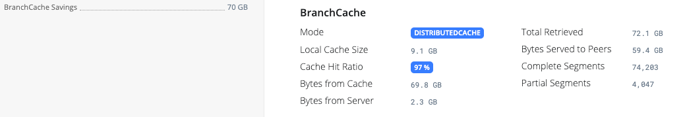

# BranchCache

The RealmJoin Agent downloads package content through BranchCache. Devices in the same network retrieve content from each other and only fetch from the RealmJoin CDN what no peer holds. For a rollout to a site, the content crosses the WAN link roughly once instead of once per device.


BranchCache is enabled by default on the RealmJoin CDN and on new RealmJoin Agent installations (`BranchCache.Mode = "Distributed"`).


## Components

* **CDN.** The RealmJoin CDN (`cdn.realmjoin.com`) serves package content BranchCache-ready: with each file it provides the content information (segment hashes) that clients use to locate the content on peers and to verify it.
* **Client library.** The agent ships the matching BranchCache client library and plugs it into its HTTP stack as a message handler. All package downloads of the agent go through it: Chocolatey (`winchoco`) packages, craft packages, and the downloads a package script makes during installation (`Get-ChocolateyWebFile`), with both the classic Chocolatey engine and the [Native Choco Runtime](native-choco-runtime.md).
* **Windows BranchCache service.** Caching and peer exchange are done by the Windows BranchCache service (`PeerDistSvc`) in **distributed cache mode**.

## Download flow

1. The agent requests a file from the CDN and receives its content information instead of the full content.
2. The device looks for the segments on its subnet: it sends a WS-Discovery multicast query, and peers that hold the segments answer directly.
3. Segments are retrieved from peers. If several peers hold the content, the load is spread across them. Segments that no peer holds are downloaded from the CDN.
4. Every segment is verified against the hashes from the content information, whether it came from a peer or from the CDN.
5. The device adds the content to its local cache and serves it to other peers from then on.

For each transfer, the agent records how many bytes came from the cache (local cache and peers) and how many came from the source, and reports these statistics to the RealmJoin CDN (`cdn.realmjoin.com`).

For protocol details see Microsoft Learn: [BranchCache](https://learn.microsoft.com/en-us/windows-server/networking/branchcache/branchcache).

## Prefetching

Before it installs pending Chocolatey packages, the agent downloads their content in the background (prefetch) to `%WINDIR%\Temp\chocolatey\<package-id>\<version>\`. This is the cache path that Chocolatey's `Get-ChocolateyWebFile` uses, so the installation picks up the prefetched files instead of downloading them again. Before a prefetched file is used, it is checked against the checksum in the package script; on a mismatch the file is downloaded again.

Prefetching is architecture-aware. Many packages contain separate installers for x64, ARM64 and x86, of which only one is used on a given device. The agent matches architecture tokens in the file names (for example `x64`, `amd64`, `arm64`, `x86`, `win32`) and prefetches:

* a single file, if the package contains only one,
* the files that match the device's architecture plus files without an architecture token, if at least one file name carries a token,
* nothing, if the package contains several files and none of them carries a token. The content is then downloaded at install time.

Prefetching is skipped on metered connections.

In a site rollout, the first device to prefetch a package pulls it from the CDN; the other devices retrieve it from that device or from other peers that already hold it.

## BranchCache and Delivery Optimization

Delivery Optimization (DO) is the Windows peer-to-peer technology for Microsoft content. It only works with Microsoft-controlled endpoints and cannot be used for third-party sources such as the RealmJoin CDN.

<table><thead><tr><th width="220"></th><th>Delivery Optimization</th><th>BranchCache</th></tr></thead><tbody><tr><td>Content</td><td>Windows Update, Microsoft Store, Microsoft 365 Apps, Intune apps</td><td>RealmJoin packages from the RealmJoin CDN</td></tr><tr><td>Configured by</td><td>Intune or group policy; the RealmJoin Agent sets the group ID</td><td>The RealmJoin Agent (<code>BranchCache.Mode</code>)</td></tr></tbody></table>

The agent sets the Delivery Optimization group ID of each device to an ID derived from the device's default gateway. Devices behind the same gateway therefore end up in the same DO group and share Microsoft content with each other. If no default gateway is found, the agent uses a random ID.

## Requirements

* **Devices.** Windows 10 and Windows 11 with the RealmJoin Agent. The agent does not use BranchCache on Windows 365 Cloud PCs.
* **Peer traffic.** Devices must be able to reach each other directly. Do not separate them into different VLANs or subnets and do not block peer traffic with client or device isolation. Microsoft lists the ports and firewall rules for distributed cache mode on Microsoft Learn: [Configure firewall rules to allow BranchCache traffic](https://learn.microsoft.com/en-us/windows-server/networking/branchcache/deploy/configure-firewall-rules-for-non-domain-members-to-allow-branchcache-traffic).
* **Distributed cache mode only.** Hosted Cache Mode (a dedicated Windows Server configured via the "Configure Hosted Cache Servers" policy) is not supported.

Endpoints, proxy guidance and the other network requirements are listed in [Infrastructure Considerations](../../deployment/infrastructure/#branchcache-and-device-isolation).

## Configuration

BranchCache is controlled by the `BranchCache.Mode` policy, assigned per user or group. See [Configure BranchCache for RJ packages](../../ugd-management/user-and-group-settings/additional-settings.md#configure-branchcache-for-rj-packages).

<table><thead><tr><th width="160">Value</th><th>Behavior</th></tr></thead><tbody><tr><td><code>"Distributed"</code></td><td>Default. Before installing a package, the agent checks whether BranchCache is available on the device. If it is not, the agent runs <code>Enable-BCDistributed -Force</code>.</td></tr><tr><td><code>"Undefined"</code></td><td>The agent does not enable BranchCache.</td></tr></tbody></table>


The setting only applies to **new** clients. `"Undefined"` does not disable BranchCache on devices where it is already active, and the agent keeps using it there. To turn it off, run `Disable-BC` in an elevated PowerShell on those devices.


On request, RealmJoin can disable BranchCache for your tenant on the CDN side. The client-side setting then has no effect.

## Checking BranchCache on a device

### In the RealmJoin Portal

The [device details](../../ugd-management/user-list/device-details.md) show the BranchCache data the agent reports for a device. The **BranchCache Savings** field in the overview shows the bytes retrieved from the local cache and from peers instead of the WAN; for devices that are not in distributed mode it shows the mode instead. The **BranchCache** section lists the mode, the local cache size, the cache hit ratio, the bytes retrieved from the cache and from the server, the total bytes retrieved, the bytes served to peers, and the number of complete and partial segments. The values are cumulative Windows BranchCache performance counters.

<figure><figcaption>
BranchCache data of a device in distributed cache mode
</figcaption></figure>

### On the device

`Get-BCStatus` in an elevated PowerShell shows the current client mode and the size of the local cache. The RealmJoin [log files](../../troubleshooting-and-faq/troubleshooting/package-installation-issues/logfiles-structure.md) contain the prefetch decisions (lines starting with `Prefetch`) and the BranchCache performance counters after each package installation.

For BranchCache errors during package downloads (for example `There is not enough space on the disk` or a hash mismatch), see [Fixes for common issues](../../troubleshooting-and-faq/troubleshooting/package-installation-issues/fixes-for-common-issues.md#branchcache-issues).
