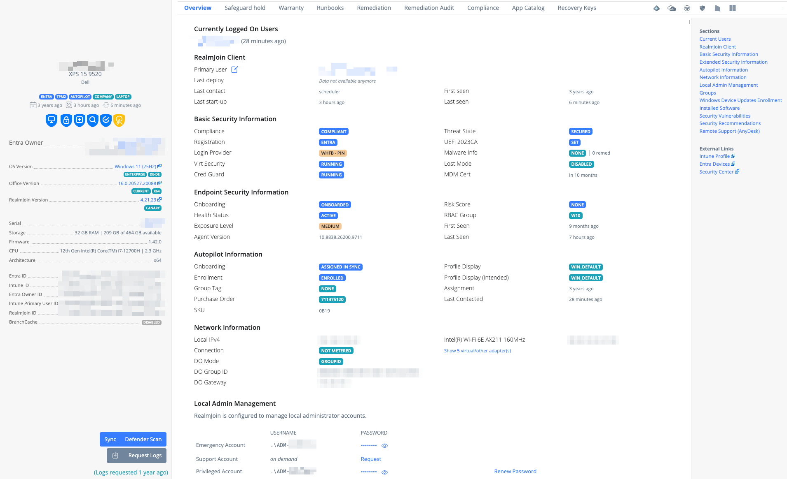
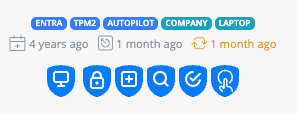
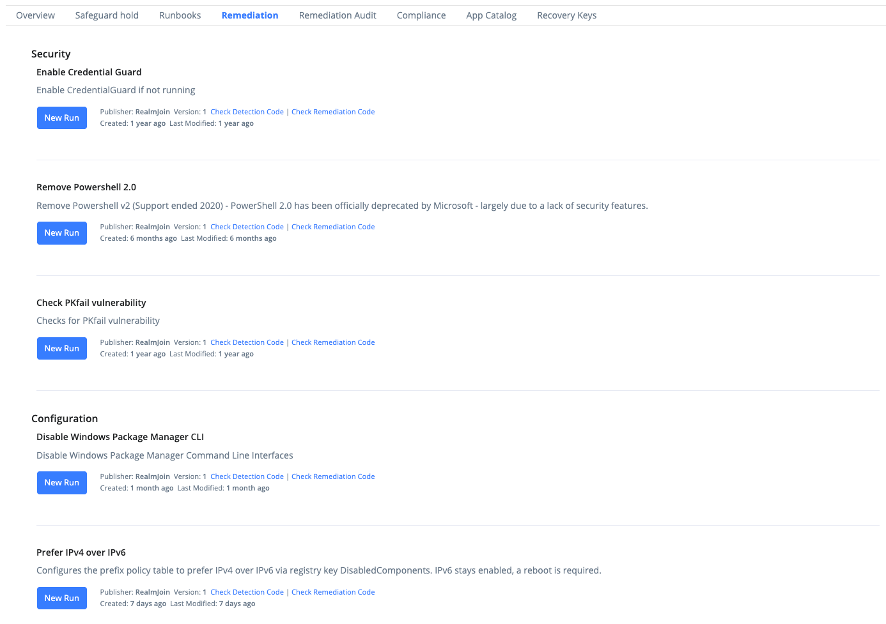
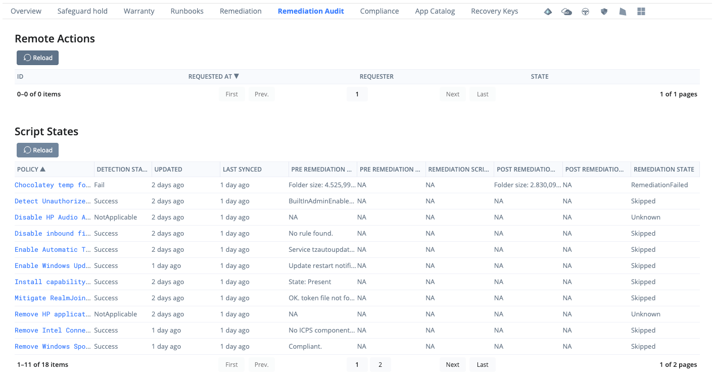
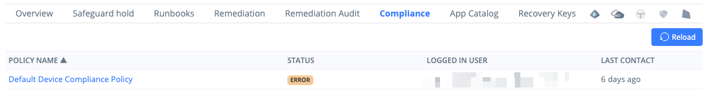
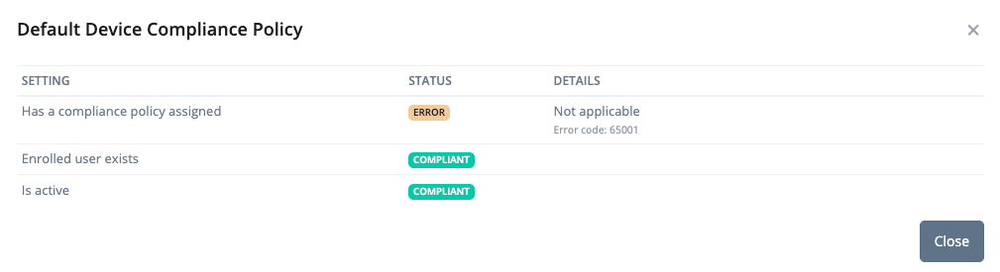
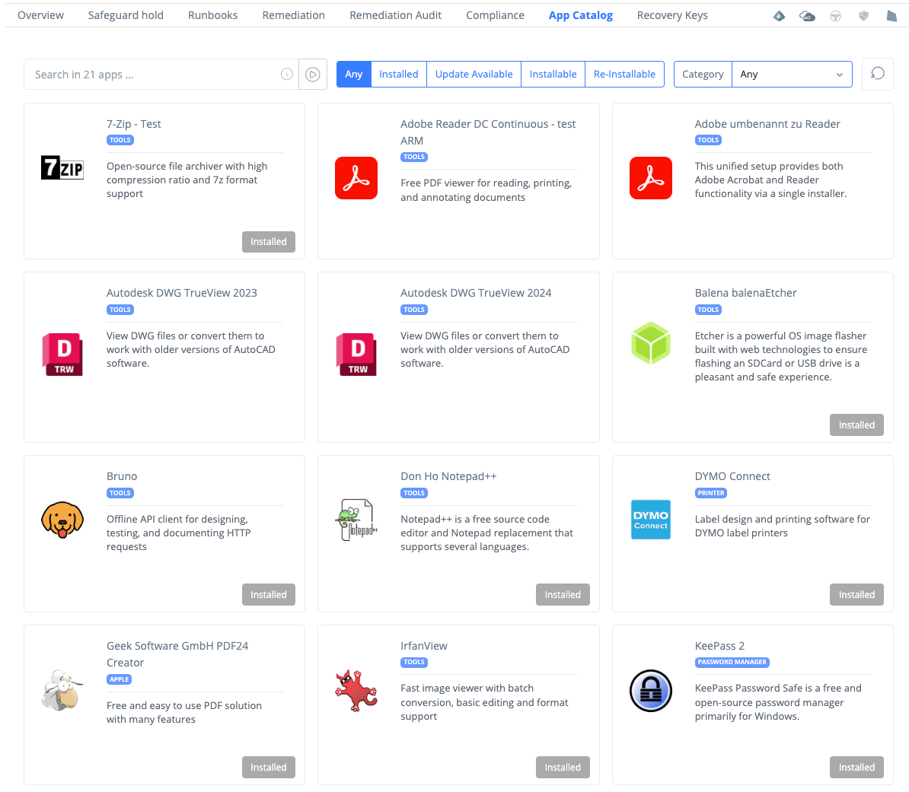
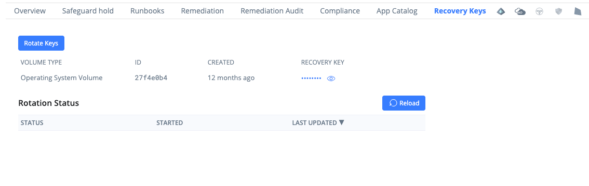

# Device Details

This page provides information about the device you’ve selected from the [Device List](./).

<figure><figcaption><p>Device details with the Overview tab</p></figcaption></figure>

The left side shows the device's core properties and stays visible in every tab. The right side shows the selected tab, by default the **Overview** tab.


Which tabs, sections and actions you see depends on your [role](../../administration-and-settings/permission/pre-defined-roles.md) or [custom role permissions](../../administration-and-settings/permission/custom-roles/available-permissions.md#device-management), on the device's platform and on the data available for it (for example whether it is managed by Intune, onboarded to Defender or runs the [RealmJoin Client](../../realmjoin-agent/realmjoin-client/)). Sections without data are hidden.


## Tabs

The tab bar above the right side holds the following tabs. A tab only appears when its condition is met and you hold the listed [permission](../../administration-and-settings/permission/custom-roles/available-permissions.md#device-management).

| Tab | Shown when | Permission |
| --- | --- | --- |
| [Overview](device-details.md#overview-tab) | Always | — |
| [Safeguard hold](device-details.md#safeguard-hold) | Windows devices, when a [Log Analytics workspace](../../monitoring-and-logs/log-analytics.md) is configured for the tenant | `CanSeeDeviceSafeguardHold` |
| [Warranty](device-details.md#warranty) | Physical devices, when the warranty feature is enabled for the tenant | `CanSeeWarranty` |
| [Runbooks](device-details.md#runbooks) | Always | `CanSeeRunbooks` |
| [Remediation](device-details.md#remediation) | Always; content only for devices managed by Intune | `CanSeeRemediationScripts` |
| [Remediation Audit](device-details.md#remediation-audit) | Always; content only for devices managed by Intune | `CanSeeRemediationScripts` |
| [Compliance](device-details.md#compliance) | Devices managed by Intune | `CanSeeDeviceCompliancePolicies` |
| [App Catalog](device-details.md#app-catalog) | Windows devices running the RealmJoin Client | `CanSeeUserAppCatalog` |
| [Recovery Keys](device-details.md#recovery-keys) | Windows and macOS devices | `CanSeeBitLockerKeys` or `CanSeeRecoveryKeys` |

The raw data tabs at the end of the bar are described under [RAW data sources](device-details.md#raw-data-sources).

## Device Summary

### **Object Properties**

The left section of the Device Details page shows the device name, model and manufacturer, followed by the core properties:

* **Entra Owner** - The registered owner of the device, or _Shared device_ for shared devices. An **Admin** badge shows that the user has local administrator permissions on the device.
* **Intune Primary User** - Shown when it differs from the Entra owner, or _Not set_
* **Enrolled By** - The user who enrolled the device in Intune, if this is a different user
* **OS Version** - Links to Microsoft's or Apple's release information. Edition and language are shown as tags below.
* **Office Version** - The installed Microsoft 365 Apps version, with update channel and platform (32/64-bit). Requires the RealmJoin Client.
* **RealmJoin Version** - The version and release channel of the RealmJoin Client. Click the version to see its changelog.
* **Serial** - Click it to open the [Warranty](device-details.md#warranty) tab
* **Storage** - RAM and free / total disk space
* **Firmware**, **CPU** and **Architecture**
* **Entra ID**, **Intune ID**, **Entra Owner ID**, **Intune Primary User ID** and **RealmJoin ID** - Click an ID to copy it to the clipboard
* **IMEI**, **ICCID** and **UDID** for mobile devices
* **BranchCache** - The BranchCache mode, or the data saved by BranchCache in distributed mode (see [BranchCache](device-details.md#branchcache))

### Status Information

The status of the device is shown as tags, dates and icons. Icons are blue (active / present), orange (warning) or red (inactive / missing). Hover over an icon to see its meaning.

<figure><figcaption><p>Tags, dates and status icons</p></figcaption></figure>

Dates, from left to right:

* **Created** - When the device object was created in Entra ID
* **Last reboot** - When Windows was last started (requires the RealmJoin Client)
* **Last activity** - Last seen activity / last contact. Shown in orange if the device has not been active for more than 7 days.

Icons, from left to right:

* **Endpoint Management** - The device is managed by Intune
* **Disk Encryption** - The device's disk is encrypted
* **Defender MDE** - The device is onboarded to Microsoft Defender for Endpoint (shown when the [Defender for Endpoint integration](../defender-integration.md) is enabled)
* **AV up-to-date** - All antivirus products report current signatures (Windows; shown when the Defender for Endpoint integration is enabled)
* **Compliant Device** - Intune reports the device as compliant. Orange means the device is compliant only because it is in its grace period. If you can see the [Compliance](device-details.md#compliance) tab, click the icon to open it.
* **WHfB Biometric** - The last sign-in used Windows Hello for Business with fingerprint or face recognition (Windows). Orange means it did not.

Tags:

* Entra - This device is Entra ID Joined
* TPM2 - TPM2 is present and enabled
* Autopilot - This device is registered with Windows Autopilot
* No Autopilot - This Windows device is not registered with Windows Autopilot
* Company - Company Owned (not Personal)
* Personal - Personal, not Company Owned
* The chassis type of a Windows device, for example Laptop or Desktop

### Notices

Below the properties, RealmJoin Portal points out conditions that need attention:

* **Disabled in Azure AD** - The device is disabled in Entra ID
* **Has not checked-in for a while** - The device has been inactive for a long time
* **Has additional admin accounts** - The RealmJoin Client found local administrator accounts that RealmJoin does not manage
* **Device telemetry not reported for some time** - The RealmJoin Client has not reported data for more than two days, while the device was active
* **This device is a virtual machine**
* **Device has critical Windows Update Safeguard Holds** - See [Safeguard hold](device-details.md#safeguard-hold)

## Actions

The buttons at the bottom of the device summary trigger actions on the device:

* **Sync** - Requests a sync, depending on the device and on who you are:
  * For devices managed by Intune, it asks Intune to sync the device (requires the `CanSyncDevice` permission).
  * If you are a user of this device yourself, it also starts a RealmJoin Client software sync on the computer you are working on.

  A notification tells you which sync was requested (_Intune sync requested_, _Client sync requested_ or _Sync requested_ for both). The button is hidden when neither applies.
* **Defender Scan** - Triggers a Microsoft Defender quick scan via Intune. Click it a second time to confirm.
* **Request Logs** - Instructs the RealmJoin Client to upload extended diagnostic logs as a ZIP file the next time it is online. When the logs are available, use the download button next to it. On devices with multiple users, you can select the user to collect logs for. See [Collecting log files](../../troubleshooting-and-faq/troubleshooting/package-installation-issues/collecting-logfiles.md).

Defender Scan requires the device to be managed by Intune.

## Overview Tab

The **Overview** tab shows all information about the device on one page. The **Sections** list on the left jumps to each section. **External Links** open the device in the Intune admin center (**Intune Profile**), in Microsoft Entra (**Entra Devices**) and in Microsoft Defender (**Security Center**).

### Currently Logged On Users

The users currently or recently signed in to the device, as reported by Intune, with the time of their sign-in.

### Windows 11

Shown for Windows 10 devices if your tenant offers the Windows 11 upgrade runbook and you are allowed to run it. Click **Upgrade** to start the upgrade of this device.

### RealmJoin Client

For devices running the [RealmJoin Client](../../realmjoin-agent/realmjoin-client/):

* **Primary user** - The user RealmJoin treats as the device's primary user. If you are allowed to, use the pencil icon to assign a different user.
* **Last deploy** - When the last initial deployment of the device started and how long it ran
* **Last contact** - What triggered the client's last contact with RealmJoin
* **Last start-up** - When the client last started
* **First seen** / **Last seen** - When RealmJoin first and last heard from the client

### Basic Security Information

* **Compliance** - The Intune compliance state. In the grace period, the remaining time is shown.
* **Registration** - How the device is registered in Entra ID: _Entra_ (joined), _On-prem_ (hybrid joined) or _Workplace_ (registered)
* **Login Provider** - How the last user signed in to Windows, for example with Windows Hello for Business fingerprint or face recognition, PIN or password
* **Virt Security** / **Cred Guard** - Whether virtualization-based security and Credential Guard are running
* **Threat State** - The threat state reported to Intune by the mobile threat defense partner
* **UEFI 2023CA** - Whether the Windows UEFI CA 2023 Secure Boot certificate is installed
* **Malware Info** - The number of remediated malware detections
* **Lost Mode** - The lost mode state of a mobile device
* **MDM Cert** - When the Intune management certificate expires

### Endpoint Security Information

For devices onboarded to Microsoft Defender for Endpoint: **Onboarding** and **Health Status**, **Exposure Level**, **Risk Score**, **Agent Version**, **RBAC Group** (the Defender device group), **First Seen** and **Last Seen**. The **Sections** list calls this section _Extended Security Information_. See [Defender for Endpoint integration](../defender-integration.md).

### Autopilot Information

For devices registered with Windows Autopilot:

* **Onboarding** - The profile assignment status, for example _Assigned In Sync_ or _Pending_
* **Enrollment** - The enrollment state
* **Group Tag**, **Purchase Order** and **SKU**
* **Profile Display** / **Profile Display (Intended)** - The assigned and the intended deployment profile
* **Assignment** / **Last Contacted** - When the profile was assigned and when the device last contacted the Autopilot service

### Extended BIOS Information

For devices with BIOS management through the RealmJoin Client: BIOS **Version**, **Password State** and **Settings State**.

### Network Information

* **Local IPv4** - As reported by Intune
* **Connection** - Whether the network connection is metered
* **DO Mode**, **DO Group ID** and **DO Gateway** - The [Delivery Optimization](https://learn.microsoft.com/en-us/windows/deployment/do/waas-delivery-optimization) group the RealmJoin Client assigned to the device and the gateway it detected
* The device's network adapters with their MAC addresses and vendors. Virtual adapters are hidden; use the link below the list to show them. Without the RealmJoin Client, the Ethernet and Wi-Fi MAC addresses reported by Intune are shown instead. These may belong to a dock or a virtual adapter.

### BranchCache

For devices that report BranchCache data: the **Mode**, **Local Cache Size** and **Cache Hit Ratio**, the bytes retrieved from the cache, from the server and in total, the bytes served to peers, and the number of complete and partial segments.

### Local Admin Management (LAPS)

RealmJoin Portal can surface a device's local administrator credentials in two independent ways, and both can appear on the same device details page:

* **RealmJoin LAPS (agent-based)** – RealmJoin's own Local Admin Password Solution, delivered by the [RealmJoin Client](../../realmjoin-agent/realmjoin-client/) and stored in your own Azure Key Vault.
* **Intune LAPS integration** – retrieval of credentials that Microsoft's native **LAPS** has backed up to Microsoft Entra ID, read directly from Microsoft Graph. No RealmJoin Client required.

The two solutions are complementary. The table below summarizes the differences:

|                               | RealmJoin LAPS (agent-based)                              | Intune LAPS integration                       |
| ----------------------------- | --------------------------------------------------------- | --------------------------------------------- |
| Credentials come from         | RealmJoin Client, stored in **your own** Azure Key Vault  | **LAPS**, backed up to Microsoft Entra ID     |
| Requires the RealmJoin Client | Yes                                                       | No                                            |
| Account types                 | **Emergency**, **Support** (on-demand) and **Privileged** | Single managed local admin account per device |
| Actions                       | Reveal password, request on-demand Support Account, renew | Reveal / copy password, rotate password       |
| Platforms                     | Windows (and macOS)                                       | Windows and macOS                             |


RealmJoin LAPS supports multiple account types, on-demand support accounts and forced rotations, and stores the credentials in your own Key Vault. The **Intune LAPS integration** only reads the credential that Microsoft's native LAPS has backed up, so support staff do not need the Intune or Entra admin center for it.


#### RealmJoin LAPS (agent-based)

When combined with the [RealmJoin Client](../../realmjoin-agent/realmjoin-client/), RealmJoin Portal can help with support tasks on windows clients that need local admin permissions by offering on-demand support accounts on clients. In many cases this removes the need to grant local admin permissions to the primary user of the device just to solve a one-time need.

.png>)

By default, a local admin emergency account is created on a windows client. This account is usable even if the client has no network connectivity, and is meant for emergencies only.

It is recommended to use a "Support Account". When clicking "**Request**", a job is created/queued and RealmJoin Client will create an on-demand local admin account next time it syncs to the backend. This can take up to 30 minutes or alternatively a "Sync this device" can be triggered on the client to speed up the process. RealmJoin Portal will show state of "Requested" until the account is created and automatically switches to a view similiar to the Emergency Account when ready:

.png>)

Click the dots to reveal the password.

The Support Account will automatically be removed after 12 hours.

See the [LAPS documentation](../../realmjoin-agent/realmjoin-client/local-admin-password-solution-laps/) for more details.

#### Intune LAPS integration

If you manage local administrator passwords with Microsoft's native **LAPS** — deployed through an Intune [account protection policy](https://learn.microsoft.com/intune/device-security/laps/deploy-policy) that backs the credential up to Microsoft Entra ID — RealmJoin Portal can read those credentials for you, so support staff don't have to switch to the Intune or Entra admin center.

Unlike RealmJoin LAPS, this integration does **not** require the RealmJoin Client. The Portal reads the credential that LAPS has backed up, via Microsoft Graph.

When the prerequisites below are met, an **Intune Local Admin Management** section appears on the device details page. It lists:

* **Username** – the local admin account name backed up from the device (Windows only; macOS does not report an account name).
* **Last Updated** – when the password was last backed up or rotated.
* **Expires** – when Windows LAPS will next rotate the password (Windows only).
* **Password** – hidden by default. Select the eye icon to reveal it (it is shown briefly, then masked again automatically) or click the masked value to copy it straight to your clipboard.

If your role allows it, a **Rotate Password** action is available. This asks Intune to generate and back up a fresh password; it is a request that Intune applies the next time the device processes it, not an instant change.


Retrieving or rotating an Intune LAPS password is audited — both within RealmJoin and in the Microsoft Entra / Intune audit logs.



Credentials can only be shown when LAPS backs the account up to **Microsoft Entra ID**. Passwords for accounts backed up to on-premises Active Directory cannot be displayed — the same limitation applies in the Intune admin center.


**Prerequisites**

* The device is **Entra ID joined** and **enrolled in Intune**.
* **LAPS is configured in Intune** and the credential is backed up to Microsoft Entra ID. See Microsoft's [Windows LAPS support in Intune](https://learn.microsoft.com/intune/device-security/laps/overview) for setup. macOS devices are supported when enrolled via Automated Device Enrollment (ADE) with a LAPS-managed local account.
* The **required Microsoft Graph permissions** are granted to the RealmJoin app registration. An administrator can grant these under **Organization ▸ Features**, in the **Optional: Intune LAPS** card:
  * `DeviceLocalCredential.Read.All` – read Windows LAPS credentials.
  * `DeviceManagementManagedDevices.PrivilegedOperations.All` – read macOS LAPS credentials **and** rotate passwords (this scope is also required to rotate a Windows password).

If a device isn't Entra/Intune managed, or the Graph permissions aren't consented, the Intune Local Admin Management section is not shown.

**Who can view and rotate**

* **View** the Intune LAPS password: Tenant Admin, Global Admin, Tenant Supporter, Tenant Advanced Supporter and Tenant Auditor roles (as well as Entra Global Administrators).
* **Rotate** the password: the same roles **except** Tenant Auditor — auditors can read credentials but not rotate them.

**Self-service for end users**

Users can be allowed to view (and optionally rotate) the Intune LAPS credential of a device they own — where they are the primary user or registered owner — using the `Allow.SelfLAPSIntune` user or group setting. This is the Intune counterpart to the agent-based [`Allow.SelfLAPS`](../../realmjoin-agent/realmjoin-client/local-admin-password-solution-laps/#enable-self-service) setting.

The value can be:

* a boolean `true` / `false` (an explicit `false` always wins),
* a platform string `"windows"` or `"macos"` to grant access for that platform only, or
* an object with `CanReadPassword` / `CanRotatePassword` (optionally platform-specific via `CanReadPasswordWindows`, `CanRotatePasswordWindows`, `CanReadPasswordMacOS`, `CanRotatePasswordMacOS`).

```json
{
  "CanReadPassword": true,
  "CanRotatePassword": false
}
```

### Groups

All groups the device is a member of, including memberships inherited through nested groups. Groups are bucketed by the RealmJoin group prefixes configured for your tenant; groups that match no prefix appear under **Other**. Each group shows its type badges (**S**ecurity / **U**nified, **S**tatic / **D**ynamic, **T**eams) and its member count, and links to its [group details](group-details.md).

### Windows Device Updates Enrollment State

For Windows devices enrolled in the [Windows Update for Business deployment service](https://learn.microsoft.com/en-us/windows/deployment/update/deployment-service-overview) (used by Windows Autopatch): the **Enrollment State** for **Driver**, **Feature** and **Quality** updates and when it last changed. Enrollment errors are listed above the table.

### Installed Software

A list of the software on this device, combining RealmJoin and Intune apps with the software inventory. Each entry shows three badges:

* **A** - Assigned: blue when the app is assigned as mandatory, red when it is mandatory but not installed
* **U** - Blue when Auto-Upgrade is set
* **M** - Blue when the app is managed by RealmJoin or Intune

Below the name you see the **SUBSCRIBED** (configured) and **DEPLOYED** versions, the version found on disk, and **USAGE** - how often and when the app was last run, if available. _APPARATED_ marks software that was found on the device but not installed by RealmJoin. Click an app name to open its details.


Intune apps and their install state come from Intune and take about 10 minutes to reflect assignment changes.


### Remote Support (AnyDesk)

Shown when the [AnyDesk integration](../../realmjoin-agent/realmjoin-client/anydesk-integration/) is set up for your tenant. It shows the device's **AnyDesk ID** and whether it is online, and the recent **Sessions**.

Click **Connect** to start a remote session. You can enter a ticket reference and a comment, which are stored with the session in AnyDesk. If the device has no AnyDesk ID yet, the user needs to start AnyDesk from the RealmJoin tray menu first.

### Security Alerts, Vulnerabilities and Recommendations

For devices onboarded to Microsoft Defender for Endpoint, the device's current **Security Alerts**, **Security Vulnerabilities** and **Security Recommendations** from Defender. Recommendations for software that updates itself are marked as _Automatic_.

### ID Resolution Mismatch

Shown in red when the device identity stored by RealmJoin no longer matches the current Entra ID and Intune records. This typically happens when the Entra device object was deleted and recreated or restored. Until the mapping is fixed, software assigned to the device may not be applied correctly. Click **Rebuild ID mapping** to fix it.

## Safeguard hold

Shows the [Windows Update Safeguard Holds](https://learn.microsoft.com/en-us/windows/deployment/update/safeguard-holds) that currently block a feature update on this Windows device, with their ID and description, or _No safeguard holds found_.

The tab appears on Windows devices once a [Log Analytics workspace](../../monitoring-and-logs/log-analytics.md) is connected to the tenant and you hold the `CanSeeDeviceSafeguardHold` permission. The holds themselves come from Windows Update for Business Reports, so the tab only shows data when that workspace is also entered under **Settings → Update Compliance**; otherwise it shows an error. See [Windows Update for Business Reports](../../monitoring-and-logs/log-analytics.md#windows-update-for-business-reports).

## Warranty

The **Warranty** tab queries the manufacturer's warranty API with the device's serial number and shows the product name, shipment or purchase date and country, followed by each warranty entitlement with its start and end date, the remaining days and whether it is active.


Currently supported vendors: Apple, Dell, Fujitsu, HP, Huawei, Lenovo and Microsoft


<figure><figcaption><p>Warranty Information</p></figcaption></figure>


We rely on the information provided by the vendors through their APIs. We do not guarantee the accuracy of this information.


For Apple and Huawei devices, the vendor API requires you to solve a captcha before the warranty information is loaded.

## Runbooks

"[Runbooks](../../automation/runbooks/)" showing available runbooks for devices. Use **New Run** to start a runbook or **Schedule** to plan a run.

## Remediation

Lists the [remediation scripts](../../automation/remediation-scripts.md) of your tenant, grouped by category, with their publisher, version and dates. Use **Check Detection Code** and **Check Remediation Code** to review a script.

<figure><figcaption><p>Remediation tab</p></figcaption></figure>

With the `CanRunRemediationScripts` permission, **New Run** runs the script on this device right away (Intune on-demand remediation).

The tab requires the `CanSeeRemediationScripts` permission and only shows content for devices managed by Intune.

## Remediation Audit

Shows what remediation activity Intune recorded for this device:

<figure><figcaption><p>Remediation Audit tab</p></figcaption></figure>

* **Remote Actions** - Remote actions requested for the device, who requested them and their state
* **Script States** - For each remediation script that ran on the device: the detection and remediation state, the script output and errors before and after remediation, and when it last ran

Same permission as the **Remediation** tab.

## Compliance

For devices managed by Intune: each compliance policy that applies to the device, with its **Status**, the user it was evaluated for (or _Device assignment_) and the **Last Contact**. Click a policy name to see the result of each of its settings on this device, with non-compliant settings listed first.

<figure><figcaption><p>Compliance tab</p></figcaption></figure>

<figure><figcaption><p>Setting results of a policy</p></figcaption></figure>

## App Catalog

For Windows devices running the RealmJoin Client: the [App Catalog](../../realmjoin-agent/client-menu/self-service-portal.md#app-catalog-tab) as the user of this device sees it. Search the apps or filter them by state (_Installed_, _Update Available_, _Installable_, _Re-Installable_) or category.

<figure><figcaption><p>App Catalog tab</p></figcaption></figure>

If you are a user of this device yourself, you can install, update, re-install or uninstall apps from here. Otherwise the catalog is read-only.

## Recovery Keys

The **Recovery Keys** tab shows the disk-encryption recovery key of Windows (**BitLocker**) and macOS (**FileVault**) devices.

<figure><figcaption><p>Recovery Keys tab (Windows)</p></figcaption></figure>

* **Windows** - The BitLocker recovery keys stored in Entra ID, with the volume type, key ID and creation date.
* **macOS** - The FileVault recovery key escrowed in Intune.

The key is hidden. Select the eye icon to reveal it for a few seconds, or click the masked value to copy it. Every retrieval is audited.

Starting with **Portal v2026.29**, you can **rotate** a device's recovery key directly from the RealmJoin Portal (**Rotate Keys** on Windows, **Rotate Key** on macOS; click a second time to confirm). Rotating replaces the existing recovery key with a new one, which takes effect after the device next syncs. The device must be managed by Intune. **Rotation Status** shows the state of the last rotation request.


Recovery keys can also be retrieved via the [Show BitLocker Recovery Key](../../automation/runbooks/runbook-references/device/security/show-bitlocker-recovery-key.md) and [Show FileVault Recovery Key](../../automation/runbooks/runbook-references/device/security/show-filevault-recovery-key.md) runbooks.


## RAW data sources

RAW [data sources](../user-group-device-management.md#data-sources) displayed as JSON, shown as icons on the right of the tab bar:

* Entra ID
* Intune
* Autopilot
* Defender (MDE)
* RealmJoin
* Windows Device Updates Enrollment

They are available to Admins, Advanced Supporters and Auditors when _Show advanced info_ is enabled in [Settings](../../administration-and-settings/general.md#show-advanced-info).


The RealmJoin state is updated when the agent checks in. Retention is 90 days. If a device is offline for more than 90 days, the state will not be available any more (icon greyed out). If it checks in again, the state will be re-evaluated and displayed after some minutes.

