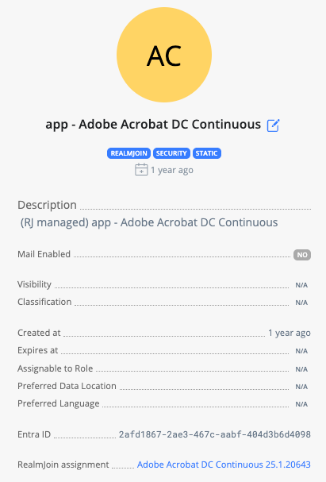
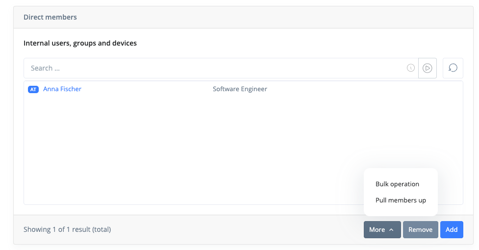
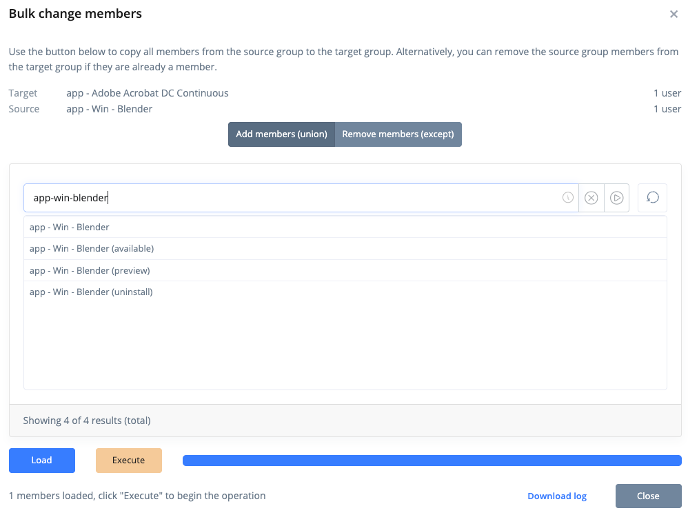

# Group Details

This page shows you details regarding a single group.


Which tabs, sections and actions you see depends on your [role](../../administration-and-settings/permission/pre-defined-roles.md) or [custom role permissions](../../administration-and-settings/permission/custom-roles/available-permissions.md#group-management).


### Object Types

The category "groups" includes:

* Microsoft Entra static and dynamic groups
* Exchange Online mail-enabled groups and distribution groups
* Microsoft Office365 groups and teams

### **Object Properties**

<figure><figcaption>
Group summary
</figcaption></figure>

The left side of the page shows the group's core properties. It does not scroll and stays visible in every tab:

* **Name** - If you are allowed to, use the pencil icon next to the name to rename the group. The name is changed in Entra ID and is limited to 120 characters.
* **Created** - When the group was created
* **Description**
* **Mail Enabled**, and for mail-enabled groups **Mail** and **Mail Nickname**
* **Visibility**, **Classification**, **Expires at**, **Assignable to Role**, **Preferred Data Location** and **Preferred Language**
* **Entra ID** - The group's object ID. Click it to copy it to the clipboard.
* **Intune assignment** / **RealmJoin assignment** - The Intune and RealmJoin apps assigned to this group, with their version. Click an app to open its details.

### Status information

Badges show the type and state of the group:

* **RealmJoin** - The group name matches one of the RealmJoin group prefixes configured for your tenant (for example `lic -`, `app -` or `cfg -`)
* **Unified** - A Office365 group or Team group
* **Security** - An Entra ID (non-Office365) group
* **Dist list** - A mail-enabled group that is not a Microsoft 365 group, such as a distribution list
* **Teams** - This group represents a Team
* **On-prem** - The group is synchronized from on-premises Active Directory
* **Static** - Members are assigned statically (manually) to a group
* **Dynamic** - Members are chosen via a membership rule, typically to group devices
* **Protected** - A RealmJoin built-in group such as "RealmJoin - All Users". It cannot be deleted and its members cannot be bulk-changed.

Be aware of the different types of groups across Entra ID and Exchange Online. A group is either a "**Security**" or a "**Unified**" group. Also, some groups like "**Security**" groups that are "**Mail enabled**" (like Distribution groups) can only be managed via Exchange Online, not Entra ID.

If a group was deleted in Entra ID but RealmJoin still knows it, the page says _This group no longer exists in Entra ID._

## Overview Tab

The **Sections** list on the left jumps to each section on the page. **External Links** open the group in Microsoft Entra (**Entra Profile**).

### Members

RealmJoin Portal will show you the current direct members of a group. Internal users, groups and devices are listed separately from external ("Guest") users. Nested groups show how many users, groups and devices they contain, including their own sub-groups. You can search/filter the members of a group using the on-screen search fields, and use **Reload** to refresh the list.

On Entra ID groups ("Non-mail enabled security" and "Unified") with static membership you can use RealmJoin Portal to add or remove members - if you have the appropriate permissions. Members of dynamic groups and of mail-enabled groups like distribution lists cannot be changed here.

Please use a [runbook](../../automation/runbooks/) to change owners of a group or to change memberships to Exchange Online groups, like Distribution Groups.

<figure><figcaption>
Members with the More menu
</figcaption></figure>

#### Adding Members

Using the "**Add**" button will show a dialogue where you can search for users, groups and devices to add to the group. You can search via Name or User Principal Name / eMail address. Microsoft 365 groups cannot be added as members.

.png>)

Press "+" to add a member to the group. The resulting membership will take a short time and not be immediately visible.

#### Removing Members

Using the "**Remove**" button will not show a new dialogue but add a "x" icon in front of existing members. You can still search/filter for members via Name or User Principal Name / eMail address while this is active.

.png>)

Press the "x" icon to remove a member. The member is removed right away, without a confirmation. The resulting change will take a short time and not be immediately visible.

#### Bulk operation

Open **More** below the member list and select **Bulk operation** to copy members between groups. Select a source group and a mode:

* **Add members (union)** - Add all members of the source group to this group
* **Remove members (except)** - Remove all members of the source group from this group

Click **Load** to load the source group's members, then **Execute**. When the operation is done, use **Download log** to get a CSV file of all changes.

<figure><figcaption>
Bulk change members
</figcaption></figure>

#### Pull members up

Use **More** > **Pull members up** to move the members of a nested group into this group. An arrow icon appears next to each nested group; click it to start. Choose whether to **Remove assignment** of the nested group afterwards (default) or **Keep assignment**, then click **Execute**.

#### Re-trigger uninstall

If the group is the uninstall group of a RealmJoin app, users and devices in the member list show a **re-trigger** button. It triggers the uninstall of these apps again for that user or on that device, for example if the first uninstall failed. The change takes effect on the next check-in of the device.

### Member of

The groups this group is a member of.

### Owners

The owners of the group. Use a [runbook](../../automation/runbooks/) to change them.

### Dynamic Group Query

For dynamic groups, the membership rule of the group. The rule cannot be changed here.

### Proxy Addresses

For mail-enabled groups, the group's mail addresses (for example SMTP aliases), each with its address type.

## Runbooks Tab

If you have been given Supporter or Admin-Permissions, this gives you access to runbooks that can be executed on this group object. For example to change an email-address of a distribution list.

See [Process Automation](../../automation/runbooks/) for more information.

## Settings Tab

You can assign Key-Value pairs of data to specific groups of users to control RealmJoin Clients behavior for these users.

<figure><figcaption>
Settings for this group
</figcaption></figure>

You can add a setting assigned to this group using , alternatively open an existing setting by clicking on its name/key or search by name/key.

Clicking a name/key will open a UI allowing you to manipulate/create the setting.

<figure><figcaption>
Settings Editor
</figcaption></figure>

Be aware: The value of the setting must be valid JSON, which includes singular values like `true` or strings (without brackets).

The switches in the lower half of the editor scope the setting to certain devices:

* **Only in VDI** / **Ignore in VDI** - Apply the setting only on, or never on, VDI devices (Windows 365, Azure Virtual Desktop)
* **Only on hybrid-joined devices** / **Ignore on hybrid-joined devices** - Apply the setting only on, or never on, hybrid-joined devices
* **Ignore on private devices** - Do not apply the setting on personal devices

Please see [Available Settings](../user-and-group-settings/additional-settings.md) for more information on which settings can be used.

## Data Sources

The **RealmJoin** tab and the **Entra ID Data** icon show the raw [data sources](../user-group-device-management.md#data-sources) as JSON. They are available to Admins, Advanced Supporters and Auditors when _Show advanced info_ is enabled in [Settings](../../administration-and-settings/general.md).

## More Actions

At the lower end of the groups details, you can find a "More" Button. Pressing it will open a menu of more available actions.

Currently, only Delete is available.

#### Delete

If you are allowed to delete the group, a confirmation dialogue will pop up upon pressing the Delete button. Delete is not available for protected groups or if you don't have enough permissions.

.png>)

Pressing "Yes" will delete the group from Entra ID. This also deletes Exchange-based objects like Distribution lists, or Microsoft 365 groups and teams. RealmJoin also removes the group from its app assignments.
